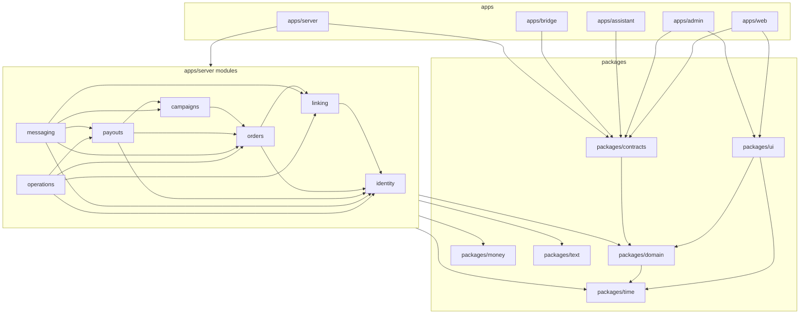
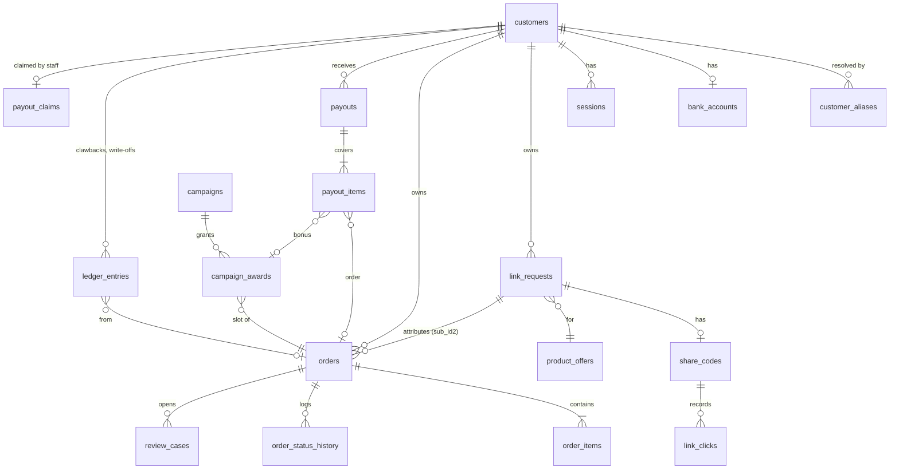

# Architecture Spine — Cashback Platform

## Design Paradigm

**Modular monolith with hexagonal modules.** One server process holds the seven bounded contexts
of `docs/domain-model.json` as seven modules. Inside each module, dependencies point inward:
`http` and `infrastructure` depend on `application`, which depends on `domain`. `domain` is pure
TypeScript. Modules meet only through each other's `index.ts` (ports, commands, queries, events).
Shared, framework-free rules live in `packages/`. The Zalo assistant and the browser bridge are
separate host processes that reach the server only through its internal API.

| Layer | Directory | May import |
| --- | --- | --- |
| Domain | `apps/server/src/modules/<context>/domain/` | `packages/money`, `packages/domain`, `packages/time`, `packages/text`; nothing else |
| Application | `.../<context>/application/` | its own domain, other modules' `index.ts`, `packages/*`, the `platform` ports (db transaction, clock, outbox, audit) |
| Infrastructure | `.../<context>/infrastructure/` | its own application and domain, Drizzle, `platform` |
| HTTP | `.../<context>/http/` | its own application, `packages/contracts`, `platform/http` |
| Platform | `apps/server/src/platform/` | `packages/*`, Fastify, Drizzle, better-sqlite3; never a module |



Arrows read "may depend on"; no other edge exists and the graph has no cycle. `messaging` and
`operations` sit on top: they read the other modules and subscribe to their events. The other
modules reach them only through two ports defined in `platform` and implemented by those two
modules: `outbox.enqueue` (AD-16) and `audit.record` / `alert` (AD-17, AD-27). `orders`, `linking`
and `payouts` publish events that `campaigns` and `messaging` consume in the same transaction
(AD-1). Frontends never import `packages/money`.

## Invariants & Rules

### AD-1 — Modular monolith, one module per bounded context

- **Binds:** all server code; contexts identity, linking, orders, payouts, campaigns, messaging, operations
- **Prevents:** two teams splitting one context across modules, or one module owning two contexts; cross-module imports into internals; cyclic dependencies
- **Rule:** The server has exactly seven modules under `apps/server/src/modules/`, named after the context ids. A module imports another only through its `index.ts`, and only along the edges of the dependency diagram above. Cross-context reactions (order approved → campaign award, notification) are in-process event handlers registered in the composition root (`apps/server/src/main.ts`) and run inside the publisher's transaction. No message broker, no second server process. dependency-cruiser enforces the edges in CI.

### AD-2 — SQLite ledger, one writer process [ADOPTED]

- **Binds:** OQ1 (resolved by the owner, 2026-10-30), all persistence, FR-12, FR-17, FR-32, FR-33
- **Prevents:** two processes writing the ledger; lost updates; long write locks; a database server to forget to run
- **Rule:** The ledger is one SQLite file in WAL mode, opened for writing only by the server process through better-sqlite3. The assistant, the bridge, scripts and dev tools never open the production file. Every write runs in `BEGIN IMMEDIATE` through the one `platform/db` transaction helper; `busy_timeout = 5000` with one retry; `foreign_keys = ON`; `synchronous = NORMAL`. A transaction never awaits network I/O. Moving to PostgreSQL is a new decision, taken only if a second writer process becomes necessary.

### AD-3 — TypeScript monorepo stack [ADOPTED]

- **Binds:** OQ2 (resolved), all apps and packages
- **Prevents:** per-app framework drift; a second validation or query library; reintroducing NestJS by habit
- **Rule:** One pnpm workspace. Server: Node 24 LTS, Fastify, Drizzle ORM over better-sqlite3, Zod; no NestJS, no decorators, no DI container — wiring is plain functions in the composition root. Frontends: React + Vite + Tailwind + shadcn/ui + TanStack Query, Table and Router. Assistant: Node + zca-js. Bridge: Chrome MV3 extension in TypeScript. Tests: Vitest; browser end-to-end tests with Playwright. Versions are pinned in the Stack table and in the lockfile.

### AD-4 — One owner per table

- **Binds:** all tables; every module
- **Prevents:** two modules writing one column; money or status changed outside its owner's rules
- **Rule:** Each table is declared in exactly one module's `infrastructure/schema.ts` and written only by that module's application commands. Other modules read it only through the owner's exported query functions. Exception: FR-37 list read models (AD-12) may join other modules' tables read-only, inside the listing module's `infrastructure/*.list.ts`, and take money and status values only from stored columns or the shared definitions (AD-10). Ownership seed: identity — customers, customer_aliases, customer_code_counter, sessions, staff, bank_accounts; linking — networks, link_requests, product_offers, share_codes, link_clicks, bridge_jobs; orders — orders, order_items, order_status_history, review_cases, reconciliation_runs, settlement_periods; payouts — payouts, payout_items, payout_claims, ledger_entries, network_settlements; campaigns — campaigns, campaign_awards; messaging — outbox, conversations; operations — audit_entries, alerts, job_leases, job_runs.

### AD-5 — One money package, integer dong, one rounding step

- **Binds:** FR-13, FR-15, FR-16, FR-17, FR-38, D1, D2, D3, D12, D20, NFR-1
- **Prevents:** the six-formula drift of the live system; float money; frontend money maths; Python-style half-even rounding
- **Rule:** `packages/money` is the only code that computes money. Every amount is a whole-dong integer (`number`, safe-integer checked). The split follows FR-13 with exact integer arithmetic (rates as integer basis points): the exact net is computed unrounded, `cashback = roundHalfUp(net × 80%)` is the only rounding that affects a customer, fee and tax are reported half-up, and `operatorShare = commission − fee − tax − cashback`. `legacyRoundHalfEven` is removed. Shopee's part is capped at 40,000 dong before the split (D2); guests get 0 (D5). Cashback is computed once, at approval, and stored on the order with the split inputs; it is never recomputed later. Every change to this package carries a golden test in `packages/golden`.

### AD-6 — Payable balance and the ledger entries

- **Binds:** FR-15, FR-16, FR-17, FR-34, D11, D27, D30, M-1, M-8
- **Prevents:** screens, chat, QR and exports disagreeing on what is owed; negative transfers; awaiting money shown as owed
- **Rule:** `payable balance = Σ stored cashback of APPROVED orders with paid_at null owned by the customer + Σ CONFIRMED campaign bonuses − Σ open clawback ledger entries`, floored at 0. It is defined once, as the payouts module query `getBalances(customerIds)` returning payable, waiting and paid, and every screen, chat reply, QR amount and export calls it. FROZEN and REVERSED orders count nowhere. A clawback is a `ledger_entries` row (kind clawback, negative amount, order id, open until netted or written off); netting happens only inside a payout confirm; write-off is an admin command with a reason. Guests (HOUSE) never appear in any balance.

### AD-7 — Order state machine in one pure function

- **Binds:** FR-12, FR-14, D4, D30, D31, status-flows §1–2, §6
- **Prevents:** reconciliation, review apply and payout void each encoding their own transitions; a paid order changed; an approved order rejected
- **Rule:** `orders/domain/transition.ts` exports `transition(order, observation) → { next, effects }`, the only place an order status changes. It applies the cancel precedence (order status, then each item, then commission 0), FROZEN on an unknown status, a missing order id or a page-cap read, REVERSED for a cancel after approval and before payout, and for PAID never changes the order but emits a clawback effect. Allowed transitions are exactly the status-flows table; anything else throws. Review apply calls the same function. Only the payouts module's confirm and void commands set or clear paid_at, through an orders port.

### AD-8 — Reconciliation: fetch apart from apply, idempotent per order

- **Binds:** FR-12, FR-13, FR-14, FR-19, R1–R6, D18, D31
- **Prevents:** double effects from overlapping periods; one network's report quirks leaking into the core; silent partial reads
- **Rule:** A network adapter's `ReportSource` yields normalized `ReportRow`s (network, order id, items, statuses, commissions, sub_ids, report fingerprint). The orders module applies each order in its own `BEGIN IMMEDIATE` transaction: attribute (sub_id1, then alias, then sub_id2 owner, else review case), `transition`, store cashback at approval, write history, audit, outbox rows and campaign effects. A row whose fingerprint equals the last applied one for that order is skipped. Hitting a page cap or the 90-day window edge marks the run failed and freezes nothing silently. Each run writes one `reconciliation_runs` row with counts.

### AD-9 — Payout claim and confirm

- **Binds:** FR-16, FR-17, FR-34, D19, D24, D32, M-3, status-flows §4
- **Prevents:** two staff paying one customer; paying a set that changed between preview and confirm; paying an order reversed during the transfer
- **Rule:** Opening a payout creates a `payout_claims` row (unique per customer, staff id, snapshot of covered order ids, bonus ids, clawback ids, amount, snapshot hash, expiry 10 minutes after the last activity). Confirm takes only claim id, snapshot hash and an optional proof image, and in one `BEGIN IMMEDIATE` transaction: checks the claim belongs to the staff member and is live, re-reads every covered order (APPROVED, paid_at null, owned by the customer), recomputes the amount, and on any difference writes nothing and returns `amount_changed` with a new preview. Because writes are serialized (AD-2), a reconciliation that reverses a covered order either commits first (confirm fails) or after (the order is PAID and gets a clawback). On success it writes the payout, payout items, paid_at and history, nets the clawbacks, writes audit and the outbox row, and deletes the claim. Void is an admin command doing the reverse in one transaction.

### AD-10 — Status registry and shared definitions in one package

- **Binds:** FR-38, LC-13, D27, status-flows.md
- **Prevents:** a screen, chat reply or export defining its own status, label, tone or "payable" meaning
- **Rule:** `packages/domain` holds every status of status-flows.md (entity, value, lifecycle order, tone, label key, customer message key, allowed transitions) and the shared definitions (payable, waiting for approval, paid, settled, has a bank account) as typed constants. A test parses `docs/operations/status-flows.md` and fails if the registry differs. Database columns store the status value; label text lives only in the resource files and is looked up by key.

### AD-11 — One time module

- **Binds:** FR-38, D28, list-defects root cause 1, campaign windows (D22)
- **Prevents:** mixed timestamp formats; UTC "today"; end dates that exclude their day; campaign windows 7 hours off
- **Rule:** `packages/time` is the only code that creates, parses or formats instants. Instants are stored as text `YYYY-MM-DDTHH:mm:ss.sssZ` (UTC, milliseconds). Business days, weeks and months use Asia/Ho_Chi_Minh. A calendar date range `[from, to]` becomes the half-open instant range `[startOfVietnamDay(from), startOfVietnamDay(to + 1 day))`. Staff-typed times are read as Vietnam time. Campaign windows are half-open (end exclusive). Domain code receives a `Clock`; no `Date.now()` or `new Date()` outside `packages/time` and `platform/clock`.

### AD-12 — One list contract

- **Binds:** FR-37, FR-38, LC-1 to LC-16, every list on both surfaces
- **Prevents:** per-screen list behaviour, the nine root causes in list-defects.md
- **Rule:** Every list is `GET /api/<surface>/<entity>` with query `q`, `filter[<field>]`, `sort=<field>:<asc|desc>`, `page`, `pageSize`, validated by a Zod schema generated from one `defineList()` spec in `apps/server/src/platform/list/`. The spec names each field once (column key = sort key = displayed value), its search fields, facets and summary. The response is `{ rows, total, page, pageSize, facets, summary, asOf }`, with page clamped by the server and facets and summary computed over the same filtered set. Search matches a stored `search_text` column built by `packages/text` (lowercase, diacritics and spaces removed, wildcards escaped); Vietnamese name order uses a stored `sort_key` column from the same package. Clients render every list with the one `DataList` component in `packages/ui`, with URL state held in a TanStack Router search schema. Each defect in list-defects.md has a regression test.

### AD-13 — In-process jobs that never overlap

- **Binds:** FR-4, FR-7, FR-12, FR-21, FR-30, FR-32, NFR-4
- **Prevents:** two runs of one job at once; a job running in a second instance; jobs drifting into separate processes
- **Rule:** Jobs run inside the server through one scheduler in `platform/jobs`. Each job reschedules itself a fixed delay after the previous run finishes: links 5 s, notify 10 s, health check 60 s, reconcile 60 min; backup daily at 03:00 Vietnam time. A run first takes its `job_leases` row (job name, holder PID, expiry); a held lease skips the run. Every run writes a `job_runs` row with outcome and duration. Migrations run only at startup, after a successful backup.

### AD-14 — Link queue and browser bridge

- **Binds:** FR-1, FR-2, FR-3, FR-4, FR-5, FR-6, FR-7, D5, D6, D7, D8, D23
- **Prevents:** mixing customers in one submission; waiting inside page scripts; links reused across customers; direct calls to Shopee
- **Rule:** The queue is the `link_requests` table (QUEUED → ISSUED → DELIVERED → CONVERTED, or FAILED). The link job claims the oldest work by priority (Zalo, then web, then HOUSE), one customer per `bridge_jobs` batch of up to 5 links sharing that customer's sub_id1. `bridge_jobs` is the one work list for the affiliate browser (kinds: link batch, product lookup, report page), served one job at a time in the order link batch, product lookup, report page, so reconciliation never delays a Zalo link by more than one job. The bridge long-polls `GET /internal/bridge/next` and posts to `POST /internal/bridge/results` with `X-Bridge-Token`; every wait and timeout is on the server; the bridge keeps its tab awake and not discarded. Product lookups read page 1 only. A captcha or page error is retried uncounted and alerts the owner; three counted failures fail the request and notify the customer. The server checks that each returned link carries the batch's sub_id1 before attaching it. Reuse looks up the same customer's own link for the same product inside the attribution window; HOUSE reuses one link per product.

### AD-15 — Zalo assistant process

- **Binds:** FR-1, FR-8, FR-9, FR-10, FR-20, FR-22, FR-36, D9, D10, D25
- **Prevents:** the assistant becoming a second writer; two sessions on one Zalo account; bursts that lock the account
- **Rule:** `apps/assistant` is a separate Node process with the only Zalo session. It never opens the database; it calls `/internal/*` on the server with `X-Assistant-Token` for registration, commands and link requests, and serves `POST /notify` on its own loopback port for the notify job, acknowledging by notification id. All message text comes from `resources/messages.vi.json` by key. Its pacer enforces human delays, no bulk sends and at most 30 friend requests a day to people who wrote first. It sends a heartbeat every 60 s; a missing heartbeat for 5 minutes raises the owner alert and the website's Zalo-down banner.

### AD-16 — Notification outbox, told once

- **Binds:** FR-4, FR-21, FR-36, D5, D11, messaging aggregate invariants
- **Prevents:** a customer told twice or never; notifications lost on restart; guests or 0-dong payouts messaged
- **Rule:** The messaging module owns `outbox`. Producers call `messaging.enqueue()` inside their own transaction with a unique dedup key `<entity>:<id>:<event>`; a duplicate key is a no-op. The notify job sends due rows to the assistant, marks them sent on acknowledgement, retries after 1, 2, 4 … minutes up to 60, and drops rows older than 7 days. `enqueue` refuses guests and 0-dong payout messages. While the assistant is down rows wait; nothing else sends Zalo messages.

### AD-17 — Append-only audit and history

- **Binds:** FR-14, FR-24, FR-29, FR-34, FR-35, D26, NFR-6
- **Prevents:** money acts without an actor; history rewritten; bank numbers in logs or audit
- **Rule:** `audit_entries`, `order_status_history` and `ledger_entries` are insert-only (no UPDATE or DELETE statements in code; triggers reject them). Every command that moves money or personal data takes an `Actor` (staff, customer, assistant, system job) and writes its audit entry in the same transaction. A bank account appears in audit only as an HMAC-SHA-256 fingerprint keyed by a secret. Erasure clears personal columns and keeps every ledger row under the permanent customer id.

### AD-18 — Listeners, sessions and access

- **Binds:** FR-9, FR-24, NFR-5, SECURITY_MODEL.md INV-5 to INV-8
- **Prevents:** internal routes on the internet; authorization by source address; customer sessions on staff routes; plaintext secrets at rest
- **Rule:** The server binds two listeners: public `127.0.0.1:8080` (the only one in the tunnel config) and internal `127.0.0.1:8081` (`/internal/*`, token-only). `trustProxy` is off. Customer and staff sessions are separate cookies (HttpOnly, Secure, SameSite=Lax) holding a random 32-byte token; only its SHA-256 hash is stored. Passwords use argon2id. Every mutating public route checks the Origin header. Staff routes check the staff session and, for admin-only actions, the role on the server. The admin hostname is also behind Cloudflare Access. Tokens are compared in constant time.

### AD-19 — Secrets outside the repository; OQ8 blocks release

- **Binds:** NFR-5, OQ8, cashback-infra rule 8
- **Prevents:** committed secrets; secrets in logs or in the browser bundle; prod and dev sharing secrets
- **Rule:** Secrets (assistant token, bridge token, fingerprint key, AccessTrade key, Telegram token, backup key recipient, Zalo credentials path) live in a per-environment env file outside the repository (`~/.config/cashback/<env>.env`), read once by `platform/config` and validated by Zod at startup. No secret reaches a frontend bundle, a log line or an error body. A secret scan runs on every commit. Rotating and removing the two secrets committed on main (OQ8) and scrubbing them from history is a release blocker for cutover.

### AD-20 — Shared contracts and one error envelope

- **Binds:** FR-20, FR-37, NFR-7, all HTTP routes and the assistant and bridge protocols
- **Prevents:** server and clients drifting on shapes; Vietnamese text in code; ad-hoc error formats
- **Rule:** `packages/contracts` holds every request and response Zod schema (public, staff, internal assistant, internal bridge). Every error is `{ error: { code, messageKey, fields? } }` with an HTTP status from one mapping; clients show text from the resource files by `messageKey`. Money fields are integer dong, instants are AD-11 strings, statuses are registry values.

### AD-21 — Two SPAs and two server-rendered pages

- **Binds:** UX spines, FR-6, FR-18, NFR-2, NFR-3, NFR-7, M-1 to M-8
- **Prevents:** a third frontend stack; money maths in the browser; a drifted copy of the label file
- **Rule:** `apps/web` (customer website) and `apps/admin` (admin desk) are Vite SPAs served as static files by the public listener. Both use `packages/ui` (shadcn/ui components, `DataList`, money and date formatters, status badge) and read the server only through `*.queries.ts` files with TanStack Query. The share page `/s/<code>` and receipt page `/b/<token>` are rendered by the server with no client framework, using the same generated token CSS. Labels come from `resources/dashboard.vi.json` imported at build time; the server reads the same file for its pages. No component computes money.

### AD-22 — One adapter per affiliate network

- **Binds:** FR-1, FR-7, FR-12, FR-13, D17, D18, D20
- **Prevents:** network rules spread across contexts; a Shopee call outside the bridge
- **Rule:** The linking module owns the network catalog (fee rate, tax rule, cap rule, sub_id format, report shape) and one adapter per network implementing `LinkCreator`, `ProductLookup` and `ReportSource`. The Shopee adapter only creates `bridge_jobs`; the AccessTrade adapter calls its HTTP API (sub1 = customer id, sub2 = request id). Other modules read network rules through the linking module's index. No Lazada adapter in the first release.

### AD-23 — Customer identity and codes

- **Binds:** FR-8, FR-9, FR-11, FR-35, D6, D10, D13, D25, D26
- **Prevents:** ids that change after a link carries them; reused codes; the web creating customers; merges that lose money
- **Rule:** `customer_id` is immutable text, letters and digits only, carried in sub_id1. `customer_code` is `DP` plus five digits from a counter that only goes up. Aliases (old Zalo ids, retired codes) resolve to the survivor through one `identity.resolveCustomer()`. Only the internal registration command creates customers. Merge refuses different bank accounts and moves orders, awards and ledger entries in one transaction. Erase refuses a customer who is owed money unless an admin forces it with a reason.

### AD-24 — Cutover by import, with parity to the dong

- **Binds:** FR-33, FR-32, NFR-1
- **Prevents:** changed ids, codes, paid times or share codes; silent time conversion errors; a cutover without a rehearsal or a way back
- **Rule:** `apps/server/src/cutover/` is a one-shot command that opens a copy of the live SQLite read-only and writes a fresh database in the new schema. It keeps every customer id, customer code, alias, order id, request id, share code, bill token, payout, campaign award and paid_at value, and keeps stored amounts as they are (no recomputation). Each live order becomes one order with one item. Every time is converted to the AD-11 format; a value that cannot be converted is listed in the import report, never guessed. A parity report compares, per customer, payable, waiting and paid amounts computed by the live system's own queries on the copy against `getBalances` on the new database, and must match to the dong. Sequence: rehearsal on a copy passes → stop live writers → backup → import → parity → switch the tunnel. Rollback: the live database is never written by the import; switch the tunnel back to the live system and restart it.

### AD-25 — Host processes on one machine, separated environments

- **Binds:** NFR-4, constraints "Host" and "Cost", cashback-infra rules 1, 2, 10
- **Prevents:** two production instances; dev touching the production Zalo account, database or affiliate session; stop scripts killing the wrong process
- **Rule:** Production runs on the operator's Mac as host processes: server, assistant and cloudflared as launchd services, the affiliate Chrome started by script with its own profile. No containers in v1. Start and stop scripts act only on the PIDs they recorded. Development differs in every resource (ports 9080/9081/9082, database, Zalo account or fake client, Chrome profile or fake bridge, no tunnel, empty PUBLIC_BASE_URL, own secrets file), as listed in `diagrams/c4-deployment.md`.

### AD-26 — Backups before migrations, daily, off the machine

- **Binds:** FR-32, FR-30, cashback-infra rule 4
- **Prevents:** losing the ledger with the disk; migrating without a way back; backups nobody has restored
- **Rule:** The backup job uses the SQLite online backup API to write a copy, runs `PRAGMA integrity_check` on it, encrypts it with age to the owner's public key, and copies it off the machine with rclone. It runs before every migration (startup refuses to migrate if it fails) and daily. Retention: 30 daily and 12 monthly copies. A restore drill on a scratch machine runs monthly and is a documented procedure. Any failure raises a high owner alert and shows on Today.

### AD-27 — Logs, alerts and health

- **Binds:** FR-25, FR-30, FR-36, NFR-4, NFR-6
- **Prevents:** personal data in logs; alert storms; health shown differently on Today and in alerts
- **Rule:** All server and assistant logs are pino JSON with a redaction list (bank numbers, phone numbers, tokens, session ids, passwords). Owner alerts go to Telegram only, through one `operations.alert(kind, severity)` with cooldowns (critical 5 min, high 15, warning 30). One health model (bridge, assistant, last reconciliation, last backup, queue depth) feeds both the Today view and the alerts.

## Consistency Conventions

| Concern | Convention |
| --- | --- |
| Naming | Ubiquitous language from the glossary in code, tables, routes and logs. Tables and columns `snake_case`, plural tables; TypeScript `camelCase`, types `PascalCase`, constants `UPPER_SNAKE_CASE`; files `kebab-case` with a role suffix (see `docs/rules/code.md`) |
| Ids | Existing ids keep their live form (customer id, customer code, order id, request id, share code, bill token). New entity ids are ULIDs as text. Every sub_id is `[a-zA-Z0-9]+` |
| Money | Integer dong in every column, field and response; names end in the meaning, not the unit (`cashback`, `approvedCommission`) |
| Time | AD-11 text instants; columns end in `_at`; calendar dates as `YYYY-MM-DD` strings named `*_date` |
| Statuses | `UPPER_SNAKE_CASE` values from `packages/domain`; never free text |
| Errors | AD-20 envelope; `code` is `snake_case` and stable; domain errors are typed results, not thrown strings |
| Mutation | Commands only in `application/`; one command = one `BEGIN IMMEDIATE` transaction including history, audit and outbox; no network I/O inside it |
| Config | `platform/config` reads the env file once and validates it; no `process.env` elsewhere |
| Auth | Public, staff and internal route groups registered separately; a route is in exactly one group |
| Domain events | Named `context.aggregate.verb` (`orders.order.approved`); payload types exported from the publisher's `index.ts`; handlers run synchronously inside the publisher's transaction, are idempotent and do no network I/O |
| Logging | Event names `context.noun.verb` (`orders.order.approved`); one line per command outcome |
| Customer text | Only resource-file keys in code (D15, NFR-7) |

## Stack

| Name | Version |
| --- | --- |
| Node.js (LTS) | 24.x (24.22.1 verified) |
| pnpm | 12.16.1 |
| TypeScript | 6.0.3 |
| Fastify | 5.12.7 |
| @fastify/cookie | 11.1.5 |
| @fastify/static | 10.1.8 |
| @fastify/rate-limit | 11.2.1 |
| Drizzle ORM | 0.45.4 |
| drizzle-kit | 0.31.11 |
| better-sqlite3 | 13.0.3 |
| SQLite | bundled with better-sqlite3 13.0.3 |
| Zod | 4.6.7 |
| @node-rs/argon2 | 2.2.2 |
| pino | 10.4.0 |
| React | 19.3.1 |
| Vite | 8.3.5 |
| Tailwind CSS | 4.3.3 |
| shadcn (CLI) | 4.23.0 |
| @tanstack/react-query | 5.105.0 |
| @tanstack/react-table | 9.3.1 |
| @tanstack/react-router | 1.170.46 |
| zca-js | 2.2.0 |
| Vitest | 5.0.5 |
| @playwright/test | 1.64.1 |
| dependency-cruiser | 18.7.0 |
| cloudflared | pinned at install, recorded in the runbook |
| age | 1.x, exact version recorded in the runbook |
| rclone | 1.x, exact version recorded in the runbook |

## Structural Seed

```text
apps/
  server/src/
    main.ts                 # composition root: config, db, modules, listeners, jobs, event wiring
    platform/               # db (transaction helper), config, clock, http (listeners, guards, errors), list (defineList), jobs, logger
    modules/
      identity/ linking/ orders/ payouts/ campaigns/ messaging/ operations/
        domain/ application/ infrastructure/ http/ index.ts
    pages/                  # server-rendered share and receipt pages
    cutover/                # one-shot import and parity report
  web/                      # customer website SPA
  admin/                    # admin desk SPA
  assistant/                # Zalo assistant process (zca-js)
  bridge/                   # Chrome MV3 browser bridge (ported from extension/)
packages/
  money/                    # the only money code + tests
  golden/                   # golden fixtures and runner (money, attribution, list defects)
  domain/                   # status registry, shared definitions
  time/                     # instants, Vietnam business days, formatters
  text/                     # search normalization, Vietnamese sort key
  contracts/                # Zod schemas for every API
  ui/                       # shadcn components, DataList, formatters, tokens
resources/                  # Vietnamese messages and labels (unchanged location)
```

Core entities (names and relationships only):



C4 views: [Context](diagrams/c4-context.md), [Container](diagrams/c4-container.md),
[Deployment](diagrams/c4-deployment.md), [Dynamic flows](diagrams/c4-dynamic.md). Threat list:
[stride.md](stride.md).

### What happens to main-v2's apps/ and packages/

| Path | Disposition |
| --- | --- |
| packages/money | Kept. `roundDong`, Shopee cap and estimate kept; `split.ts` rewritten to FR-13 (AD-5); `legacyRoundHalfEven` and the unused tax-policy parameter dropped |
| packages/golden | Kept. Fixtures extended with the four FR-13 golden cases, the 2026-09-25 reuse case and every list defect |
| packages/contracts | Kept as a package, schemas rewritten to the new model and the AD-20 envelope |
| packages/ui | Rewritten on shadcn/ui with the DESIGN.md tokens and `DataList` |
| apps/server | Rewritten: NestJS removed, new schema, seven context modules. Pure domain pieces are ported with their tests (sub-id, share-code, request-id, reuse-policy, AccessTrade order parsing). Deals, F&B vouchers, ShopeeFood and Lazada code dropped (D17, D29) |
| apps/admin, apps/web | Rewritten to the UX spines; the payout dialog and VietQR helper are reference only |
| apps/assistant | Ported: pacer, message parsing, friend requests, bank details, commands and the zca adapter kept with their tests, moved onto the new contracts and the outbox protocol |
| packages/domain, packages/time, packages/text, apps/bridge | New |

## Capability → Architecture Map

| Capability / Area | Lives in | Governed by |
| --- | --- | --- |
| FR-1, FR-4, FR-5, FR-7 link request, delivery, reuse, queue | linking, assistant, bridge | AD-14, AD-15, AD-16, AD-22 |
| FR-2, FR-3 web and guest links | linking http (public), web | AD-14, AD-18, AD-23 |
| FR-6 share page | server pages, linking | AD-21, AD-14 |
| FR-8, FR-9, FR-10, FR-11, FR-35 customer account, sign-in, bank, merge, erase | identity, assistant, web | AD-23, AD-18, AD-17 |
| FR-12, FR-14 reconciliation, review cases | orders, linking adapters | AD-7, AD-8, AD-22 |
| FR-13 cashback | packages/money, orders | AD-5 |
| FR-15 balance and orders | payouts query, orders read model, web, assistant | AD-6, AD-12 |
| FR-16, FR-17, FR-34 payable list, payout, void | payouts, admin | AD-6, AD-9 |
| FR-18 receipt page | server pages, payouts | AD-21 |
| FR-19 network settlement | payouts | AD-4, AD-6 |
| FR-20, FR-21, FR-22, FR-36 chat, notifications, Zalo safety, Zalo loss | messaging, assistant | AD-15, AD-16, AD-27 |
| FR-23 campaigns | campaigns | AD-1, AD-11 |
| FR-24, FR-25, FR-26, FR-27 staff, Today, customers and orders, metrics | identity, operations, admin | AD-18, AD-27, AD-12 |
| FR-29, FR-31 audit, fraud flags | operations | AD-17 |
| FR-30 owner alerts | operations | AD-27 |
| FR-32 backups | platform jobs | AD-26, AD-13 |
| FR-33 cutover | server cutover | AD-24 |
| FR-37 list contract | platform/list, packages/ui DataList | AD-12 |
| FR-38 time and status vocabulary | packages/time, packages/domain | AD-10, AD-11 |
| NFR-1 money correctness | packages/money, packages/golden | AD-5, AD-6, AD-9 |
| NFR-5, NFR-6 security, privacy | platform/http, identity, operations | AD-17, AD-18, AD-19, SECURITY_MODEL.md |
| NFR-9 file size | all code | docs/rules/code.md |

## Deferred

- **PostgreSQL.** Revisit only when a second writer process is needed (AD-2).
- **Redis or any broker.** The link queue and outbox are tables; revisit if a second server process is ever needed.
- **Containers (Docker Compose).** Host processes are simpler on one Mac with a host Chrome and Zalo session; revisit when the server moves to a VPS. cashback-infra compose rules apply then.
- **AccessTrade postback webhook.** Hourly polling meets FR-12; the webhook can be added behind the same `ReportSource` port.
- **Staging with its own Zalo account.** Out of MVP scope (PRD §8.2); dev separation (AD-25) is required, a second Zalo account is the owner's call.
- **CI provider and pipeline shape.** Required checks are named in `docs/rules/code.md`; the provider is chosen with the first build story.
- **Lazada adapter, dark theme, public metrics pages.** Out of scope (D17, UX open items, PRD §8.2).
- **Moving production off the home machine.** The constraint allows a small VPS only if needed; nothing in this spine requires it.
- **TypeScript 7.** Pinned to 6.0.3 until the lint toolchain supports 7.x.
