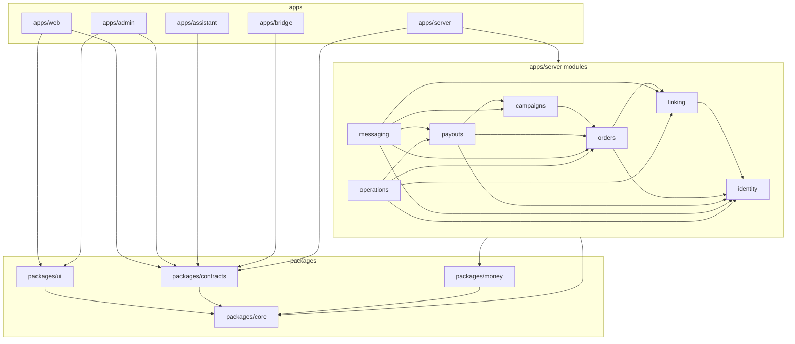
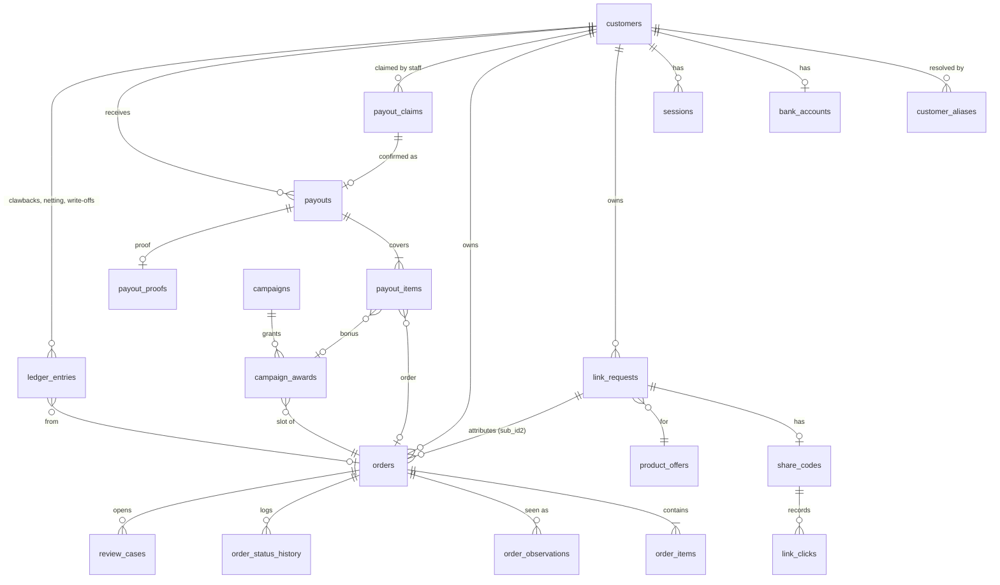

# Architecture Spine — Cashback Platform

## Design Paradigm

**Modular monolith with a pure core per module** (revised 2026-10-30 after independent review, S1,
D52). One server process holds the seven bounded contexts of `docs/domain-model.json` as seven
modules. Inside each module, `domain/` is pure TypeScript (the transition function, rules, value
types); the module's commands, queries, repositories and adapters are plain files next to it; and
`http/` holds its routes. Nearly every port has one adapter, so there are no separate application
and infrastructure layers. Modules meet only through each other's `index.ts` (commands, queries,
events). Shared, framework-free rules live in `packages/core` (time, text, status registry and
shared definitions); money lives alone in `packages/money` because it is the money boundary. The
Zalo assistant and the browser bridge are separate host processes that reach the server only
through its internal API.

| Layer | Directory | May import |
| --- | --- | --- |
| Domain | `apps/server/src/modules/<context>/domain/` | `packages/money`, `packages/core`; nothing else |
| Module code | `.../<context>/*.command.ts`, `*.query.ts`, `*.repository.ts`, `*.list.ts`, `*.adapter.ts`, `schema.ts` | its own domain, other modules' `index.ts`, `packages/*`, Drizzle, the `platform` ports (db transaction, clock, outbox, audit) |
| HTTP | `.../<context>/http/` | its own module's commands and queries, `packages/contracts`, `platform/http` |
| Platform | `apps/server/src/platform/` | `packages/*`, Fastify, Drizzle, better-sqlite3; never a module |



Arrows read "may depend on"; no other edge exists and the graph has no cycle. `messaging` and
`operations` sit on top: they read the other modules and subscribe to their events. The other
modules reach them only through two ports defined in `platform` and implemented by those two
modules: `outbox.enqueue` (AD-16) and `audit.record` / `alert` (AD-17, AD-27). `orders`, `linking`
and `payouts` publish events that `campaigns` and `messaging` consume in the same transaction
(AD-1). The order observation that marks a link request `CONVERTED` is a linking event handler on
`orders.order.recorded`, never an orders write to a linking table. Frontends never import
`packages/money`.

## Invariants & Rules

### AD-1 — Modular monolith, one module per bounded context (revised 2026-10-30 after independent review)

- **Binds:** all server code; contexts identity, linking, orders, payouts, campaigns, messaging, operations
- **Prevents:** two teams splitting one context across modules, or one module owning two contexts; cross-module imports into internals; cyclic dependencies
- **Rule:** The server has exactly seven modules under `apps/server/src/modules/`, named after the context ids. A module imports another only through its `index.ts`, and only along the edges of the dependency diagram above. Cross-context reactions (order approved → campaign award, notification; order recorded → link request converted) are in-process event handlers registered in the composition root (`apps/server/src/main.ts`) and run inside the publisher's transaction. No message broker, no second server process. dependency-cruiser enforces the edges in CI.

### AD-2 — SQLite ledger, one writer process [ADOPTED] (revised 2026-10-30 after independent review)

- **Binds:** OQ1 (resolved by the owner, 2026-10-30), D33, all persistence, FR-12, FR-17, FR-32, FR-33
- **Prevents:** two processes writing the ledger; lost updates; long write locks; code that runs outside the transaction it appears to be in; a database server to forget to run
- **Rule:** The ledger is one SQLite file in WAL mode, opened for writing only by the server process through better-sqlite3 (D33). The assistant, the bridge, scripts and dev tools never open the production file; ad-hoc inspection uses `sqlite3 -readonly` only, and every fix is an admin-desk command, never a script. Every write runs in `BEGIN IMMEDIATE` through the one `platform/db` transaction helper `tx(fn)`, which is synchronous and throws if `fn` returns a thenable; a lint rule forbids passing an `async` callback to `tx`. `busy_timeout = 1000` with one retry; `foreign_keys = ON`; `synchronous = NORMAL`. A transaction never awaits network I/O. Migrations are forward-only, each one is run against a copy of the latest production backup before deploy, and a failed migration restores the pre-migration copy automatically. Moving to PostgreSQL is a new decision, taken only if a second writer process becomes necessary.

### AD-3 — TypeScript monorepo stack [ADOPTED]

- **Binds:** OQ2 (resolved), all apps and packages
- **Prevents:** per-app framework drift; a second validation or query library; reintroducing NestJS by habit
- **Rule:** One pnpm workspace. Server: Node 24 LTS, Fastify, Drizzle ORM over better-sqlite3, Zod; no NestJS, no decorators, no DI container — wiring is plain functions in the composition root. Frontends: React + Vite + Tailwind + shadcn/ui + TanStack Query, Table and Router. Assistant: Node + zca-js. Bridge: Chrome MV3 extension in TypeScript. Tests: Vitest; browser end-to-end tests with Playwright. Versions are pinned in the Stack table and in the lockfile.

### AD-4 — One owner per table (revised 2026-10-30 after independent review)

- **Binds:** all tables; every module
- **Prevents:** two modules writing one column; money or status changed outside its owner's rules
- **Rule:** Each table is declared in exactly one module's `schema.ts` and written only by that module's commands. Other modules read it only through the owner's exported query functions. Exception: FR-37 list read models (AD-12) may join other modules' tables read-only, inside the listing module's `*.list.ts`, and take money and status values only from stored columns or the shared definitions (AD-10). Ownership seed: identity — customers, customer_aliases, customer_code_counter, sessions, staff, bank_accounts; linking — networks, link_requests, product_offers, share_codes, link_clicks, bridge_jobs; orders — orders (with `last_seen_in_report_at`), order_items, order_observations, order_status_history, review_cases, reconciliation_runs, settlement_periods; payouts — payouts, payout_items, payout_claims, payout_proofs, ledger_entries, network_settlements; campaigns — campaigns, campaign_awards; messaging — outbox, conversations; operations — audit_entries, alerts. There is no `job_leases` or `job_runs` table (AD-13).

### AD-5 — One money package, integer dong, one rounding step (revised 2026-10-30 after independent review)

- **Binds:** FR-13, FR-15, FR-16, FR-17, FR-27, FR-38, D1, D2, D3, D12, D20, D34, D54, NFR-1
- **Prevents:** the six-formula drift of the live system; float money; frontend money maths; Python-style half-even rounding; report amounts scaled and rounded inside an adapter; the operator silently absorbing withheld tax
- **Rule:** `packages/money` is the only code that computes money. Every amount is a whole-dong integer (`number`, safe-integer checked). The split follows FR-13 with exact integer arithmetic (rates as integer basis points): the exact net is computed unrounded, `cashback = roundHalfUp(net × 80%)` is the only rounding that affects a customer (D34), fee and tax are reported half-up, and `operatorShare = commission − fee − tax − cashback`. `legacyRoundHalfEven` is removed. Shopee's part is capped at 40,000 dong before the split (D2); guests get 0 (D5). Network report amounts enter only through `fromNetworkUnits(value, scale)` (half-up, golden fixtures for each scale the reports use). A Shopee settlement period counts as withheld unless staff unmark it; unmarking affects only approvals after it (D54). Cashback is computed once, at approval, and stored on the order with the split inputs; it is never recomputed later. SQL may `SUM()` stored integer columns for list summaries and for the Overview operator figures ("what we keep", "networks still owe us"); any other arithmetic, and every ratio (FR-27), is computed in `packages/money`. Every change to this package carries a golden test in `packages/golden`.

### AD-6 — Payable balance and the ledger entries (revised 2026-10-30 after independent review)

- **Binds:** FR-15, FR-16, FR-17, FR-34, D11, D27, D30, D35, D42, M-1, M-8
- **Prevents:** screens, chat, QR and exports disagreeing on what is owed; negative transfers; awaiting money shown as owed; a clawback that can never close; a balance card whose rows do not add up
- **Rule:** `gross = Σ stored cashback of APPROVED orders with paid_at null + Σ CONFIRMED campaign bonuses`; `payable balance = max(0, gross − Σ open clawbacks)`. It is defined once, as the payouts module query `getBalances(customerIds)` returning payable, waiting, paid and `deductedNext` (the open clawbacks), resolved over the customer and its aliases; every screen, chat reply, QR amount and export calls it, and the customer balance card shows `deductedNext` as its own line whenever it is above 0. FROZEN and REVERSED orders count nowhere. A clawback is a series of insert-only `ledger_entries` sharing one clawback id: the negative original (the order's stored cashback plus any PAID bonus on that order, D35) and positive netting and write-off entries; its open amount is the sum of its entries. Confirm nets open clawbacks up to the gross and carries the rest forward. A customer whose open clawbacks reach the gross appears in the payable list as "netting only"; a netting-only payout (transfer 0) marks the orders PAID, writes the netting entries, shows no QR and sends no message. Write-off is an admin command with a reason. Guests (HOUSE) never appear in any balance.

### AD-7 — Order state machine in one pure function (revised 2026-10-30 after independent review)

- **Binds:** FR-12, FR-14, D4, D30, D31, D38, D39, D43, D55, status-flows §1–2, §6
- **Prevents:** reconciliation, review apply and payout void each encoding their own transitions; a paid order changed; a normal unpaid-by-buyer order rejected forever; a cancel applied while the operator is transferring money for that order
- **Rule:** `orders/domain/transition.ts` exports `transition(order, observation, context) → { next, effects }`, the only place an order status changes. The observation carries normalized statuses from the network's status map (AD-22), never raw strings. It applies the cancel precedence (order status, then each item, then commission 0), FROZEN on an unknown status or a missing order id, REVERSED for a cancel after approval and before payout, and for PAID never changes the order but emits a clawback effect. When `context` says the order is covered by an OPEN payout claim, a cancel observation is stored in `order_observations` and not applied, and its fingerprint is not stored; the next run after the claim ends applies it (D39). An approved commission that drops but stays above 0 freezes an APPROVED unpaid order with a review case and emits a partial clawback for a PAID one (D55). A cancel signal on an APPROVED or PAID order also opens a review case. Staff may move a wrongly REJECTED order back to AWAITING_APPROVAL only through a review case whose latest observation shows no cancel signal (D38). Allowed transitions are exactly the status-flows table; anything else throws. Review apply and payout void call the same function. Only the payouts module's confirm and void commands set or clear paid_at, through an orders port.

### AD-8 — Reconciliation: fetch apart from apply, idempotent per order (revised 2026-10-30 after independent review)

- **Binds:** FR-12, FR-13, FR-14, FR-19, R1–R6, D18, D31, D43
- **Prevents:** double effects from overlapping periods; one network's report quirks leaking into the core; silent partial reads; a 30-to-70-day approval never being read; paging the Shopee report into captcha; review apply becoming manual attribution
- **Rule:** A network adapter's `ReportSource` yields normalized `ReportRow`s (network, order id, items, mapped statuses, commissions in dong, sub_ids, report fingerprint). The hourly run reads the last 7 days by purchase time. A nightly paced sweep reads, in one-day slices with a page cap per slice, every calendar day that still holds an AWAITING_APPROVAL order or an APPROVED unpaid order; bridge report jobs yield to link jobs between pages (AD-14). A slice that hits its cap fails the run, freezes no order and alerts the owner (D43). The orders module applies each order in its own `BEGIN IMMEDIATE` transaction: attribute, `transition`, store cashback at approval, set `last_seen_in_report_at`, write history, audit, outbox rows and campaign effects. Attribution is sub_id1 resolved through aliases, else the sub_id2 request's owner; when both exist and disagree, or neither resolves, a review case opens. A review case shows only the candidate the rules produce (alias, sub_id2 owner or merge survivor) and staff cannot choose another customer. A row whose fingerprint equals the last applied one for that order is skipped. An imported order seen for the first time gets its items stored without recomputing its stored amounts; only a cancel signal changes it. R5 aging (14 and 60 days) is computed from `last_seen_in_report_at`. Each run writes one `reconciliation_runs` row with counts.

### AD-9 — Payout claim and confirm (revised 2026-10-30 after independent review)

- **Binds:** FR-16, FR-17, FR-34, D19, D24, D32, D39, D41, D42, M-3, status-flows §4
- **Prevents:** two staff paying one customer; paying a set that changed between preview and confirm; refusing to record a transfer that already left the bank; a second transfer after a lost confirm; a void that makes a cancelled order payable
- **Rule:** The operator transfers before confirming, so the claim protects the transfer. Opening a payout creates a `payout_claims` row (status OPEN, unique OPEN per customer, staff id, snapshot of covered order ids, bonus ids, clawback ids, amount, bank account fingerprint and hold flag, snapshot hash, `qr_shown_at`, transfer reference = customer code plus a short claim id). A claim idle for 10 minutes becomes ABANDONED; rows are never deleted. Orders covered by an OPEN claim are protected (AD-7). Confirm takes only claim id, snapshot hash and an optional proof image, and in one `BEGIN IMMEDIATE` transaction: returns the existing payout if the claim is already CONFIRMED (idempotent by claim id); otherwise accepts an OPEN claim, or an ABANDONED one when no other OPEN claim exists for the customer; re-reads every covered order (APPROVED, paid_at null, owned by the customer), the bank account and the hold; recomputes the hash; on any difference writes nothing and returns `amount_changed` with a new preview. On success it writes the payout, payout items, paid_at and history, nets clawbacks (AD-6), writes audit and the outbox row, and marks the claim CONFIRMED. Opening a customer whose last claim is ABANDONED with `qr_shown_at` set shows "may have transferred <amount> at <time>: check the bank before paying". Void is an admin command in one transaction: each covered order gets the state `transition()` gives from its latest observation (REVERSED if a cancel was seen, else APPROVED) with paid_at cleared; a clawback on that order is closed by an offsetting entry; netting entries written by the voided payout are reversed by offsetting entries; bonuses return to CONFIRMED, or to VOID when their order is now REVERSED (D41). All four void combinations are golden-tested.

### AD-10 — Status registry and shared definitions in one package (revised 2026-10-30 after independent review)

- **Binds:** FR-38, LC-13, D27, status-flows.md
- **Prevents:** a screen, chat reply or export defining its own status, label, tone or "payable" meaning
- **Rule:** `packages/core/status` holds every status of status-flows.md (entity, value, lifecycle order, tone, label key, customer message key, allowed transitions; the payout claim is its own entity) and the shared definitions (payable as the net figure of AD-6, waiting for approval, paid, settled, has a bank account) as typed constants. A test parses `docs/operations/status-flows.md` and fails if the registry differs. Database columns store the status value; timed states such as customer `LOCKED` are derived from a stored time and never stored. Label text lives only in the resource files and is looked up by key.

### AD-11 — One time module (revised 2026-10-30 after independent review)

- **Binds:** FR-38, D28, list-defects root cause 1, campaign windows (D22)
- **Prevents:** mixed timestamp formats; UTC "today"; end dates that exclude their day; campaign windows 7 hours off
- **Rule:** `packages/core/time` is the only code that creates, parses or formats instants. Instants are stored as text `YYYY-MM-DDTHH:mm:ss.sssZ` (UTC, milliseconds). Business days, weeks and months use Asia/Ho_Chi_Minh. A calendar date range `[from, to]` becomes the half-open instant range `[startOfVietnamDay(from), startOfVietnamDay(to + 1 day))`. Staff-typed times are read as Vietnam time. Campaign windows are half-open (end exclusive). Domain code receives a `Clock`; no `Date.now()` or `new Date()` outside `packages/core/time` and `platform/clock`.

### AD-12 — One list contract (revised 2026-10-30 after independent review)

- **Binds:** FR-37, FR-38, LC-1 to LC-16, every list on both surfaces
- **Prevents:** per-screen list behaviour, the nine root causes in list-defects.md; a module writing another module's search column
- **Rule:** Every list is `GET /api/<surface>/<entity>` with query `q`, `filter[<field>]`, `sort=<field>:<asc|desc>`, `page`, `pageSize`, validated by a Zod schema generated from one `defineList()` spec in `apps/server/src/platform/list/`. The spec names each field once (column key = sort key = displayed value), its search fields, facets and summary. The response is `{ rows, total, page, pageSize, facets, summary, asOf }`, with page clamped by the server and facets and summary computed over the same filtered set. Search matches stored `search_text` columns built by `packages/core/text` (lowercase, diacritics and spaces removed, wildcards escaped); each table builds its own, and a list that searches across contexts (orders by customer name) matches the join of each table's own `search_text` in its `*.list.ts`. Vietnamese name order uses a stored `sort_key` column from the same package. Clients render every list with the one `DataList` component in `packages/ui`, with URL state held in a TanStack Router search schema. Each defect in list-defects.md has a regression test.

### AD-13 — In-process jobs that never overlap (revised 2026-10-30 after independent review)

- **Binds:** FR-4, FR-7, FR-12, FR-21, FR-30, FR-32, NFR-4, D52
- **Prevents:** two runs of one job at once; a second server instance on the same data; false refusals from a reused PID after a reboot; jobs drifting into separate processes
- **Rule:** Jobs run inside the server through one scheduler in `platform/jobs`. At startup the server takes an exclusive OS lock on `data/<env>/server.lock` and refuses to start if it is held. Each job has an in-memory running flag and reschedules itself a fixed delay after the previous run finishes: links 5 s, claim expiry 60 s, health check 60 s, reconcile 60 min (7-day window), nightly sweep 02:00 Vietnam time, backup daily 03:00 Vietnam time. Job outcomes are log lines (AD-27); `reconciliation_runs` stays because it is business data. Migrations run only at startup, after a successful local backup (AD-26).

### AD-14 — Link queue and browser bridge (revised 2026-10-30 after independent review)

- **Binds:** FR-1, FR-2, FR-3, FR-4, FR-5, FR-6, FR-7, D5, D6, D7, D8, D23, D47
- **Prevents:** mixing customers in one submission; losing sub_id2; links matched by position; waiting inside page scripts; links reused across customers; direct calls to Shopee; `/s/<code>` as an open redirect; a silent logged-out affiliate session
- **Rule:** The queue is the `link_requests` table (QUEUED → ISSUED → DELIVERED → CONVERTED, or FAILED). The link job claims the oldest request by priority (Zalo, then web, then HOUSE) and sends one link per submission with sub_id1 = customer id and sub_id2 = request id (D47); one bridge job never holds two customers. `bridge_jobs` is the one work list for the affiliate browser (kinds: link, product lookup, report page), served one job at a time in the order link, product lookup, report page, so reconciliation never delays a Zalo link by more than one page. The bridge long-polls `GET /internal/bridge/next` and posts to `POST /internal/bridge/results` with `X-Bridge-Token`; every wait and timeout is on the server; the bridge keeps its tab awake and not discarded. Product lookups read page 1 only. A captcha or page error is retried uncounted and alerts the owner; a redirect of the custom-link page to the login page pauses the queue, alerts the owner and points to the runbook re-login step. Three counted failures fail the request and notify the customer. Before attaching a returned link, the server checks its host against an allow-list (Shopee and AccessTrade domains) and resolves the short link's redirect outside any transaction to check that it carries the request's sub_ids; a link that fails either check is dropped and counted as a failure. New share codes are 10 base62 characters; the validator also accepts the live 8-character codes. Reuse looks up the same customer's own link for the same product inside the attribution window; HOUSE reuses one link per product.

### AD-15 — Zalo assistant process (revised 2026-10-30 after independent review)

- **Binds:** FR-1, FR-8, FR-9, FR-10, FR-20, FR-22, FR-36, D9, D10, D25, D52
- **Prevents:** the assistant becoming a second writer; two sessions on one Zalo account; bursts that lock the account; a second listener and token boundary
- **Rule:** `apps/assistant` is a separate Node process with the only Zalo session. It never opens the database and serves no listener; it calls `/internal/*` on the server with `X-Assistant-Token` for registration, commands and link requests, and pulls notifications with `GET /internal/notifications/next`, acknowledging each with `POST /internal/notifications/<id>/ack`. It keeps a small local file of sent notification ids so a redelivered row is not sent twice (at-least-once delivery). All message text comes from `resources/messages.vi.json` by key. Its pacer enforces human delays, no bulk sends and at most 30 friend requests a day to people who wrote first. Bank-detail reads and changes are refused in groups. It sends a heartbeat every 60 s; a missing heartbeat for 5 minutes raises the owner alert and the website's Zalo-down banner.

### AD-16 — Notification outbox, told once (revised 2026-10-30 after independent review)

- **Binds:** FR-4, FR-21, FR-22, FR-36, D5, D9, D11, D46, messaging aggregate invariants
- **Prevents:** a customer told twice or never; notifications lost on restart; guests or netting-only payouts messaged; a burst that locks the Zalo account
- **Rule:** The messaging module owns `outbox`. Producers call `messaging.enqueue()` inside their own transaction with a unique dedup key `<entity>:<id>:<event>`; a duplicate key is a no-op. `/internal/notifications/next` hands out one due row at a time; a row not acknowledged within 2 minutes becomes due again after 1, 2, 4 … minutes up to 60, and rows older than 7 days are dropped. Proactive sends have a hard daily cap (default 150, in config); at the cap rows wait for the next day and the owner is alerted. A server flag `messaging.silent` makes `enqueue` record would-be sends without making them due (used for the first run after cutover, AD-24). `enqueue` refuses guests and netting-only payouts. While the assistant is down rows wait; nothing else sends Zalo messages.

### AD-17 — Append-only audit and history (revised 2026-10-30 after independent review)

- **Binds:** FR-14, FR-24, FR-29, FR-34, FR-35, D26, D42, NFR-6
- **Prevents:** money acts without an actor; history rewritten; bank numbers or names in logs or audit; erasure blocked by audit content
- **Rule:** `audit_entries`, `order_status_history`, `order_observations` and `ledger_entries` are insert-only (no UPDATE or DELETE statements in code; triggers reject them); state that changes over time, such as a clawback's open amount, is a sum of entries (AD-6). Every command that moves money or personal data takes an `Actor` (staff, customer, assistant, system job) and writes its audit entry in the same transaction. Audit payloads carry ids and fingerprints only, never names, phone numbers or bank numbers; a bank account appears only as an HMAC-SHA-256 fingerprint keyed by a secret. Erasure clears personal columns, `search_text` and `sort_key`, and keeps every ledger row under the permanent customer id.

### AD-18 — Listeners, sessions and access (revised 2026-10-30 after independent review)

- **Binds:** FR-2, FR-9, FR-24, NFR-5, D48, SECURITY_MODEL.md INV-5 to INV-8
- **Prevents:** internal routes on the internet; staff routes reached through the public host around Cloudflare Access; authorization by source address; customer sessions on staff routes; sign-in spraying and lockout of every customer; one actor exhausting the web link quota; plaintext secrets at rest
- **Rule:** The server binds two listeners: public `127.0.0.1:8080` (the only one in the tunnel config) and internal `127.0.0.1:8081` (`/internal/*`, token-only). `trustProxy` is off. The staff route group is registered only for `Host` = the admin host, so `hoantiendp.com/api/admin/*` does not exist, and every staff route verifies the `Cf-Access-Jwt-Assertion` JWT (team domain and audience from config) in addition to the staff session (D48). Customer and staff sessions are separate cookies (HttpOnly, Secure, SameSite=Lax) holding a random 32-byte token; only its SHA-256 hash is stored. Passwords use argon2id. After five failed sign-ins a customer code waits a growing delay (1, 2, 4 … minutes, capped at 15) recorded in `locked_until`; a burst of failed sign-ins across codes raises an owner alert. Cloudflare rate-limiting and WAF rules cover `/api/session` and the link endpoints; `CF-Connecting-IP` is read only as a rate-limit key, never for authorization. Every mutating public route checks the Origin header. Staff routes check the role on the server for admin-only actions. Tokens are compared in constant time.

### AD-19 — Secrets outside the repository; OQ8 rotated now (revised 2026-10-30 after independent review)

- **Binds:** NFR-5, OQ8, D16, D51, cashback-infra rule 8
- **Prevents:** committed secrets; secrets in logs or in the browser bundle; prod and dev sharing secrets; live secrets exposed until cutover
- **Rule:** Secrets (assistant token, bridge token, fingerprint key, AccessTrade key, Telegram token, Cloudflare Access audience, heartbeat URL, backup key recipient, Zalo credentials path) live in a per-environment env file outside the repository (`~/.config/cashback/<env>.env`), read once by `platform/config` and validated by Zod at startup. No secret reaches a frontend bundle, a log line or an error body. A secret scan runs on every commit. The two secrets committed on main (OQ8) are rotated now by the owner on the live system and in Cloudflare, without any code change on main, and the GitHub repository is made private (D16, D51; see Risks and Owner Actions). The new platform never reuses those values.

### AD-20 — Shared contracts and one error envelope

- **Binds:** FR-20, FR-37, NFR-7, all HTTP routes and the assistant and bridge protocols
- **Prevents:** server and clients drifting on shapes; Vietnamese text in code; ad-hoc error formats
- **Rule:** `packages/contracts` holds every request and response Zod schema (public, staff, internal assistant, internal bridge). Every error is `{ error: { code, messageKey, fields? } }` with an HTTP status from one mapping; clients show text from the resource files by `messageKey`. Money fields are integer dong, instants are AD-11 strings, statuses are registry values.

### AD-21 — Two SPAs and two server-rendered pages (revised 2026-10-30 after independent review)

- **Binds:** UX spines, FR-6, FR-17, FR-18, NFR-2, NFR-3, NFR-6, NFR-7, D49, M-1 to M-8
- **Prevents:** a third frontend stack; money maths in the browser; a drifted copy of the label file; bank screenshots on a public page; uploaded files executing on the customer origin
- **Rule:** `apps/web` (customer website) and `apps/admin` (admin desk) are Vite SPAs served as static files by the public listener. Both use `packages/ui` (shadcn/ui components, `DataList`, money and date formatters, status badge) and read the server only through `*.queries.ts` files with TanStack Query. The share page `/s/<code>` and receipt page `/b/<token>` are rendered by the server with no client framework, using the same generated token CSS. The receipt page shows facts only (customer code, last four digits, amount, date, voided state) and never the proof image (D49). Proof images are accepted only as JPEG or PNG, re-encoded on upload with EXIF stripped, stored in `payout_proofs` files under the backed-up `data/<env>/files/`, and served only to staff and to the signed-in customer with a fixed `Content-Type`, `X-Content-Type-Options: nosniff` and a strict CSP. Labels come from `resources/dashboard.vi.json` imported at build time; the server reads the same file for its pages. No component computes money.

### AD-22 — One adapter per affiliate network (revised 2026-10-30 after independent review)

- **Binds:** FR-1, FR-7, FR-12, FR-13, D17, D18, D20, D38
- **Prevents:** network rules spread across contexts; a Shopee call outside the bridge; a network's raw status read as a cancel by a generic list
- **Rule:** The linking module owns the network catalog (fee rate, tax rule, cap rule, sub_id format, report shape, amount scale, status map) and one adapter per network implementing `LinkCreator`, `ProductLookup` and `ReportSource`. Each adapter maps every raw order and item status it knows explicitly to `AWAITING`, `APPROVED` or `CANCELLED`; anything else is `UNKNOWN` (FROZEN). The Shopee map starts from the live `STATUS_MAP` in `src/cashback/shopee/report_reader.py` (read as reference, unchanged): `UNPAID` (buyer has not paid yet), `PAID`, `COMPLETED` and `DELIVERED` mean awaiting, and only validated or approved means approved (D38). Every map is golden-tested on fixtures made from real report rows, including unpaid, completed, validated and cancelled rows. The Shopee adapter only creates `bridge_jobs`; the AccessTrade adapter calls its HTTP API (sub1 = customer id, sub2 = request id). Other modules read network rules through the linking module's index. No Lazada adapter in the first release.

### AD-23 — Customer identity and codes (revised 2026-10-30 after independent review)

- **Binds:** FR-8, FR-9, FR-10, FR-11, FR-35, D6, D10, D13, D25, D26, D42
- **Prevents:** ids that change after a link carries them; reused codes; the web creating customers; merges that lose money or touch paid orders
- **Rule:** `customer_id` is immutable text, letters and digits only, carried in sub_id1. `customer_code` is `DP` plus five digits from a counter that only goes up. Aliases (old Zalo ids, retired codes) resolve to the survivor through one `identity.resolveCustomer()`. Only the internal registration command creates customers. Merge refuses different bank accounts and, in one transaction, marks the merged customer MERGED and records it as an alias of the survivor; it moves no order, award or ledger entry, and every balance, list and attribution resolves through aliases. A bank change made from the Zalo private chat needs no further confirmation (FR-10; accepted risk in SECURITY_MODEL.md); a website change is held until confirmed in Zalo and carries the 72-hour flag. Erase refuses a customer who is owed money unless an admin forces it with a reason. `LOCKED` is derived from `locked_until` (AD-18).

### AD-24 — Cutover by import, shadow-checked, with a go/no-go window (revised 2026-10-30 after independent review)

- **Binds:** FR-33, FR-32, NFR-1, D34, D40, D44, D45, D46
- **Prevents:** changed ids, codes, paid times or share codes; live defects imported as payable; campaign windows converted 7 hours wrong; a burst of Zalo messages on day one; a rollback that reopens double payment
- **Rule:** `apps/server/src/cutover/` is a one-shot command that opens a copy of the live SQLite read-only and writes a fresh database in the new schema. It keeps every customer id, customer code, alias, order id, request id, share code (8 characters), bill token, payout, campaign award and paid_at value, and keeps stored amounts as they are (D34). Each live order becomes one order with one item (AD-8 stores the real items later). Times follow a per-column conversion table in `cutover/` (column, source zone, fallback), each entry with a fixture test: `CURRENT_TIMESTAMP` columns are naive UTC, campaign start and end are Vietnam time, and dates synthesized from the order SN prefix are flagged `approximate`; a value that fits no rule is listed in the import report, never guessed (D45). QUEUED live link requests and unsent live notifications are imported or listed. The import seeds a dedup key as already sent for every (entity, event) the live system already notified (D46). Parity: paid totals per customer match to the dong; payable and waiting come from a shadow run of the new reconciliation on the rehearsal copy over the full report window, which produces a per-order diff of expected transitions that the owner signs off; "live payable" is one named SQL in the cutover tool; an unresolved order older than the report can verify becomes FROZEN with a review case (D44). Day-one sequence: shadow diff signed off → secrets confirmed rotated → live stopped (server, assistant, and the old extension removed from the affiliate Chrome profile) → backup → import with seeded keys → parity → first reconciliation with `messaging.silent` on, reporting would-be sends → tunnel switch → no payouts in the new system for a 72-hour go/no-go window → watch the pacer counters. Rollback is allowed only inside that window: switch the tunnel back to the untouched live system and restart it; after the window the new system is final (D40).

### AD-25 — Host processes on one machine, separated environments (revised 2026-10-30 after independent review)

- **Binds:** NFR-4, D37, constraints "Host" and "Cost", cashback-infra rules 1, 2, 10
- **Prevents:** two production instances; dev touching the production Zalo account, database or affiliate session; dev links reconciling into production; stop scripts killing the wrong process
- **Rule:** Production runs on the operator's Mac as host processes: server, assistant and cloudflared as launchd services, and the affiliate Chrome as a launchd LaunchAgent in the logged-in GUI session with its own profile. No containers in v1. Start and stop scripts act only on the PIDs they recorded; the server lock file (AD-13) refuses a second instance. Development differs in every resource (ports 9080/9081, database, its own Zalo account or the fake client (D37), the fake bridge or a Chrome profile never signed in to the production Shopee account, no tunnel, empty PUBLIC_BASE_URL, own secrets file), as listed in `diagrams/c4-deployment.md`. Dev sub_id1 values carry a `DEV` prefix, which production attribution never resolves, so a stray dev link reaches production only as a review case.

### AD-26 — Backups before migrations, daily, off the machine, checked automatically (revised 2026-10-30 after independent review)

- **Binds:** FR-32, FR-30, D36, D52, cashback-infra rule 4
- **Prevents:** losing the ledger with the disk; migrating without a way back; no server when the internet is down at restart; backups nobody has restored; proof images lost with the disk
- **Rule:** The backup job uses the SQLite online backup API to write a local copy of the ledger together with `data/<env>/files/` (proof images), runs `PRAGMA integrity_check` on it, restores it into a temporary file and compares row counts with the live database, encrypts it with age to the owner's public key, and copies it to Google Drive with rclone (D36). Startup migrations are gated on the local copy and its integrity check only; the off-site copy runs afterwards and alerts on failure. It runs before every migration and daily. Retention: 30 daily and 12 monthly copies. A manual restore drill runs once at cutover and once a quarter. Restore: stop the server, delete the `-wal` and `-shm` files with the database, put the restored file in place, run `integrity_check`, start. The secrets file and the cloudflared credentials are not in the backup; they are rebuilt by hand from the owner's password manager, as the runbook says. Any failure raises a high owner alert and shows on the Overview.

### AD-27 — Logs, alerts and health

- **Binds:** FR-25, FR-30, FR-36, NFR-4, NFR-6
- **Prevents:** personal data in logs; alert storms; health shown differently on the Overview and in alerts
- **Rule:** All server and assistant logs are pino JSON with a redaction list (bank numbers, phone numbers, tokens, session ids, passwords). Owner alerts go to Telegram only, through one `operations.alert(kind, severity)` with cooldowns (critical 5 min, high 15, warning 30). One health model (bridge, assistant, last reconciliation, last backup, queue depth) feeds both the Overview (FR-25) and the alerts.

### AD-28 — v1 cutover scope and build order

- **Binds:** FR-11, FR-19, FR-23, FR-24, FR-25, FR-27, FR-29, FR-31, FR-33, D53, NFR-1
- **Prevents:** cutover waiting on screens no money path needs; a big-bang build with nothing deployable until the end; risks found only on day one
- **Rule:** v1 cutover scope is what paying, attributing and reconciling depend on: FR-1 to FR-10, FR-12 to FR-17, FR-18 (facts-only receipt), FR-20 to FR-22, FR-25 (Overview with the one quiet metrics line), FR-26, FR-30, FR-31 shared-bank-account flag only, FR-32 to FR-38, the audit trail written by every command (FR-29 data), and the merge, campaign and staff commands as admin commands with preview and apply. After cutover: FR-27 metrics beyond the Overview line, FR-31 other flags, the FR-19 settlement screen, the FR-23 campaign creation UI (imported awards are honoured by `getBalances`; a campaign needed at cutover is created by admin command), the FR-11 merge UI, the FR-24 staff management UI (staff are seeded), the FR-29 audit trail screen, and the Guide page redesign. Build order, each slice deployable to dev: (1) `packages/money` and `packages/core` with golden tests, including the status-map fixtures and `fromNetworkUnits`; (2) the cutover import and shadow reconciliation against a copy of the live database, read-only, beside live; (3) server skeleton: `platform/db`, config, both listeners, the orders module with `transition()`, `getBalances` and a bare Payouts screen with claim, confirm and void; (4) linking, the bridge with one link per submission, the assistant with the pull outbox, the share page; (5) customer website: sign in, My money, Account; (6) backups, alerts, the external heartbeat (AD-29), the cutover rehearsal.

### AD-29 — Liveness checked from outside the machine

- **Binds:** FR-30, NFR-4, D37, D50
- **Prevents:** total silence when the Mac loses power, sleeps, loses its internet, or waits at the FileVault pre-boot screen after a reboot
- **Rule:** The server pings an external heartbeat checker (healthchecks.io free tier, or a Cloudflare Worker cron) every 5 minutes while its health model is green; the checker alerts the owner on Telegram when pings stop for 15 minutes. The Mac is set with `pmset` to never sleep and to restart after a power failure, sits on a UPS if possible, and the runbook has a FileVault reboot step (someone types the password at the machine, then the LaunchAgents start Chrome and the services).

## Consistency Conventions

| Concern | Convention |
| --- | --- |
| Naming | Ubiquitous language from the glossary in code, tables, routes and logs. Tables and columns `snake_case`, plural tables; TypeScript `camelCase`, types `PascalCase`, constants `UPPER_SNAKE_CASE`; files `kebab-case` with a role suffix (see `docs/rules/code.md`) |
| Ids | Existing ids keep their live form (customer id, customer code, order id, request id, share code, bill token). New entity ids are ULIDs as text. Every sub_id is `[a-zA-Z0-9]+` |
| Money | Integer dong in every column, field and response; names end in the meaning, not the unit (`cashback`, `approvedCommission`) |
| Time | AD-11 text instants; columns end in `_at`; calendar dates as `YYYY-MM-DD` strings named `*_date` |
| Statuses | `UPPER_SNAKE_CASE` values from `packages/core/status`; never free text |
| Errors | AD-20 envelope; `code` is `snake_case` and stable; domain errors are typed results, not thrown strings |
| Mutation | Commands only in `*.command.ts`; one command = one synchronous `BEGIN IMMEDIATE` transaction including history, audit and outbox; no network I/O inside it |
| Config | `platform/config` reads the env file once and validates it; no `process.env` elsewhere |
| Auth | Public, staff and internal route groups registered separately; a route is in exactly one group; the staff group exists only on the admin host |
| Domain events | Named `context.aggregate.verb` (`orders.order.approved`); payload types exported from the publisher's `index.ts`; handlers run synchronously inside the publisher's transaction, are idempotent and do no network I/O |
| Logging | Event names `context.noun.verb` (`orders.order.approved`); one line per command outcome and per job run |
| Customer text | Only resource-file keys in code (D15, NFR-7) |

## Stack

| Name | Version |
| --- | --- |
| Node.js (LTS) | 24.x (24.22.1 verified) |
| pnpm | 12.16.1 |
| TypeScript | 6.0.3 |
| Fastify | 5.12.7 |
| @fastify/cookie | 11.1.5 |
| @fastify/static | 10.1.8 |
| @fastify/rate-limit | 11.2.1 |
| Drizzle ORM | 0.45.4 |
| drizzle-kit | 0.31.11 |
| better-sqlite3 | 13.0.3 |
| SQLite | bundled with better-sqlite3 13.0.3 |
| Zod | 4.6.7 |
| @node-rs/argon2 | 2.2.2 |
| pino | 10.4.0 |
| React | 19.3.1 |
| Vite | 8.3.5 |
| Tailwind CSS | 4.3.3 |
| shadcn (CLI) | 4.23.0 |
| @tanstack/react-query | 5.105.0 |
| @tanstack/react-table | 9.3.1 |
| @tanstack/react-router | 1.170.46 |
| zca-js | 2.2.0 |
| Vitest | 5.0.5 |
| @playwright/test | 1.64.1 |
| dependency-cruiser | 18.7.0 |
| cloudflared | pinned at install, recorded in the runbook |
| age | 1.x, exact version recorded in the runbook |
| rclone | 1.x, exact version recorded in the runbook |

## Structural Seed

```text
apps/
  server/src/
    main.ts                 # composition root: config, db, lock file, modules, listeners, jobs, event wiring
    platform/               # db (synchronous tx helper), config, clock, http (listeners, guards, Access JWT, errors), list (defineList), jobs, logger
    modules/
      identity/ linking/ orders/ payouts/ campaigns/ messaging/ operations/
        domain/             # pure: transition, rules, value types
        http/               # routes
        *.command.ts *.query.ts *.repository.ts *.list.ts *.adapter.ts schema.ts index.ts
    pages/                  # server-rendered share and receipt pages
    cutover/                # one-shot import, per-column time table, shadow reconciliation diff, parity report
  web/                      # customer website SPA
  admin/                    # admin desk SPA
  assistant/                # Zalo assistant process (zca-js), pulls notifications
  bridge/                   # Chrome MV3 browser bridge (ported from extension/)
packages/
  money/                    # the only money code + tests
  golden/                   # golden fixtures and runner (money, status maps, attribution, void, list defects)
  core/                     # time, text (search, sort key), status registry and shared definitions
  contracts/                # Zod schemas for every API
  ui/                       # shadcn components, DataList, formatters, tokens
resources/                  # Vietnamese messages and labels (unchanged location)
```

Core entities (names and relationships only):



C4 views: [Context](diagrams/c4-context.md), [Container](diagrams/c4-container.md),
[Deployment](diagrams/c4-deployment.md), [Dynamic flows](diagrams/c4-dynamic.md). Threat list:
[stride.md](stride.md). Independent review and its resolution:
[review-independent.md](review-independent.md).

### What happens to main-v2's apps/ and packages/

| Path | Disposition |
| --- | --- |
| packages/money | Kept. `roundDong`, Shopee cap and estimate kept; `split.ts` rewritten to FR-13 (AD-5); `fromNetworkUnits` added; `legacyRoundHalfEven` and the unused tax-policy parameter dropped |
| packages/golden | Kept. Fixtures extended with the four FR-13 golden cases, the 2026-09-25 reuse case, the network status maps from real report rows, the four void combinations and every list defect |
| packages/contracts | Kept as a package, schemas rewritten to the new model and the AD-20 envelope |
| packages/ui | Rewritten on shadcn/ui with the DESIGN.md tokens and `DataList` |
| apps/server | Rewritten: NestJS removed, new schema, seven context modules. Pure domain pieces are ported with their tests (sub-id, share-code, request-id, reuse-policy, AccessTrade order parsing). Deals, F&B vouchers, ShopeeFood and Lazada code dropped (D17, D29) |
| apps/admin, apps/web | Rewritten to the UX spines; the payout dialog and VietQR helper are reference only |
| apps/assistant | Ported: pacer, message parsing, friend requests, bank details, commands and the zca adapter kept with their tests, moved onto the new contracts and the pull outbox protocol |
| packages/core, apps/bridge | New |

## Capability → Architecture Map

| Capability / Area | Lives in | Governed by |
| --- | --- | --- |
| FR-1, FR-4, FR-5, FR-7 link request, delivery, reuse, queue | linking, assistant, bridge | AD-14, AD-15, AD-16, AD-22 |
| FR-2, FR-3 web and guest links | linking http (public), web | AD-14, AD-18, AD-23 |
| FR-6 share page | server pages, linking | AD-21, AD-14 |
| FR-8, FR-9, FR-10, FR-11, FR-35 customer account, sign-in, bank, merge, erase | identity, assistant, web | AD-23, AD-18, AD-17 |
| FR-12, FR-14 reconciliation, review cases | orders, linking adapters | AD-7, AD-8, AD-22 |
| FR-13 cashback | packages/money, orders | AD-5 |
| FR-15 balance and orders | payouts query, orders read model, web, assistant | AD-6, AD-12 |
| FR-16, FR-17, FR-34 payable list, payout, void | payouts, admin | AD-6, AD-9 |
| FR-18 receipt page | server pages, payouts | AD-21 |
| FR-19 network settlement (screen after cutover) | payouts | AD-4, AD-6, AD-28 |
| FR-20, FR-21, FR-22, FR-36 chat, notifications, Zalo safety, Zalo loss | messaging, assistant | AD-15, AD-16, AD-27 |
| FR-23 campaigns (creation UI after cutover) | campaigns | AD-1, AD-11, AD-28 |
| FR-24, FR-25, FR-26, FR-27 staff, Overview (with one FR-27 line), customers and orders | identity, operations, admin | AD-18, AD-27, AD-12, AD-28 |
| FR-29, FR-31 audit, fraud flags | operations | AD-17, AD-28 |
| FR-30 owner alerts | operations | AD-27, AD-29 |
| FR-32 backups | platform jobs | AD-26, AD-13 |
| FR-33 cutover | server cutover | AD-24, AD-28 |
| FR-37 list contract | platform/list, packages/ui DataList | AD-12 |
| FR-38 time and status vocabulary | packages/core | AD-10, AD-11 |
| NFR-1 money correctness | packages/money, packages/golden | AD-5, AD-6, AD-7, AD-9 |
| NFR-4 availability | platform jobs, operations, host | AD-25, AD-27, AD-29 |
| NFR-5, NFR-6 security, privacy | platform/http, identity, operations | AD-17, AD-18, AD-19, AD-21, SECURITY_MODEL.md |
| NFR-9 file size | all code | docs/rules/code.md |

## Risks and Owner Actions

- **Live secrets exposed now (H11, OQ8, D51). Owner action, not a code change.** The repository may
  be public and two secrets are committed on main. The owner rotates both values now on the live
  system's environment and in Cloudflare, without changing any code on main, and makes the GitHub
  repository private (the D16 precondition for committing planning documents). Scrubbing history
  would rewrite main and is left to the owner; once rotated, the old values are dead.
- **Shopee session loss.** A logged-out affiliate session pauses the link queue (AD-14); re-login
  needs someone at the machine. Remote re-login is not addressed.
- **Zalo account takeover.** A bank change from the Zalo private chat needs no confirmation, so a
  taken-over Zalo account can redirect payouts. Accepted (SECURITY_MODEL.md).
- **Operator machine loss or compromise.** Accepted under full-disk encryption and a production-only
  OS account (D37); data is restored from backup (AD-26), sessions by hand.
- **Withheld default (D54).** Customers of a period that turns out not withheld receive 10% less
  for approvals before the period is unmarked; stored amounts are never recomputed.

## Deferred

- **PostgreSQL.** Revisit only when a second writer process is needed (AD-2, D33).
- **Redis or any broker.** The link queue and outbox are tables; revisit if a second server process is ever needed.
- **Containers (Docker Compose).** Host processes are simpler on one Mac with a host Chrome and Zalo session; revisit when the server moves to a VPS. cashback-infra compose rules apply then.
- **AccessTrade postback webhook.** Hourly polling meets FR-12; the webhook can be added behind the same `ReportSource` port.
- **Staging with its own Zalo account.** Out of MVP scope (PRD §8.2); a dev environment with its own Zalo account exists before the rehearsal (D37).
- **Screens after cutover.** The FR list in AD-28 "after cutover", and the PRD Release scope section.
- **Campaign slot mechanics (review M14).** Slot allocation, re-evaluation and closing get their own AD with the campaign creation UI, after cutover; imported awards are honoured as they are.
- **CI provider and pipeline shape.** Required checks are named in `docs/rules/code.md`; the provider is chosen with the first build story.
- **Lazada adapter, dark theme, public metrics pages.** Out of scope (D17, UX open items, PRD §8.2).
- **Moving production off the home machine.** The constraint allows a small VPS only if needed; nothing in this spine requires it.
- **TypeScript 7.** Pinned to 6.0.3 until the lint toolchain supports 7.x.
