# C4 Container — Cashback Platform

Legend: every job and the queue is its own element (C4 project rule 3). The server is one
Node process and the only writer of the ledger (AD-2); the jobs run inside it (AD-13). The Zalo
assistant and the affiliate browser are host processes on the operator's machine (AD-25). The
public listener is reached only through the Cloudflare tunnel; the internal listener is loopback
only and token-protected (AD-18).

```mermaid
C4Container
  title Container diagram - Cashback Platform

  Person(customer, "Customer", "Zalo and phone browser")
  Person(operator, "Operator / staff", "Laptop or phone")

  System_Ext(zalo, "Zalo", "Personal account")
  System_Ext(shopee, "Shopee Affiliate", "Web pages, real session")
  System_Ext(accesstrade, "AccessTrade", "Publisher API")
  System_Ext(telegram, "Telegram", "Owner alerts")
  System_Ext(cf, "Cloudflare edge", "Tunnel, TLS, Access on admin host")
  System_Ext(offsite, "Off-machine backup store", "rclone remote, encrypted copies")

  System_Boundary(p, "Cashback Platform") {
    Container(web, "Customer website", "React, Vite, Tailwind, shadcn/ui", "Sign in, my money, account, link converter")
    Container(admin, "Admin desk", "React, Vite, Tailwind, shadcn/ui", "Today, payouts, orders, customers, review, campaigns")
    Container(server, "Server", "Node 24, Fastify, Drizzle", "7 context modules; public API, share and receipt pages; internal API")
    ContainerQueue(linkq, "Link queue", "link_requests table", "QUEUED requests, Zalo first")
    Container(linkjob, "Link job (5 s)", "in-process job", "Hands one customer's batch to the bridge, applies results")
    ContainerQueue(outbox, "Notification outbox", "outbox table", "One row per change to tell, unique dedup key")
    Container(notifyjob, "Notify job (10 s)", "in-process job", "Delivers due outbox rows to the assistant")
    Container(recjob, "Reconciliation run (60 min)", "in-process job", "Reads network reports, applies order transitions")
    Container(backupjob, "Backup job (daily)", "in-process job", "Online backup, integrity check, encrypt, copy off machine")
    ContainerDb(db, "Ledger", "SQLite, WAL", "Customers, links, orders, payouts, ledger entries, audit")
    Container(assistant, "Zalo assistant", "Node 24, zca-js, host process", "Chat commands, registration, paced sends")
    Container(bridge, "Browser bridge", "Chrome MV3 extension in the affiliate Chrome profile", "Drives Shopee pages; no waiting in page scripts")
  }

  Rel(customer, cf, "Opens hoantiendp.com", "HTTPS")
  Rel(operator, cf, "Opens the admin host", "HTTPS")
  Rel(cf, server, "Forwards to the public listener", "cloudflared to 127.0.0.1:8080")
  Rel(server, web, "Serves the bundle")
  Rel(server, admin, "Serves the bundle")
  Rel(web, server, "Calls the public API", "JSON")
  Rel(admin, server, "Calls the staff API", "JSON")
  Rel(customer, zalo, "Chats")
  Rel(assistant, zalo, "Receives and sends messages", "zca-js")
  Rel(assistant, server, "Registers, runs commands, requests links", "X-Assistant-Token, 127.0.0.1:8081")
  Rel(server, linkq, "Enqueues link requests")
  Rel(linkjob, linkq, "Claims the next batch")
  Rel(bridge, linkjob, "Long-polls for work, posts results", "X-Bridge-Token, 127.0.0.1:8081")
  Rel(bridge, shopee, "Creates links, reads page 1, reads the report", "real browser session")
  Rel(server, accesstrade, "Creates links, reads transactions", "HTTPS")
  Rel(recjob, bridge, "Asks for the Shopee report through the link channel")
  Rel(recjob, db, "Applies transitions, one transaction per order")
  Rel(server, outbox, "Inserts in the same transaction as the change")
  Rel(notifyjob, outbox, "Reads due rows, marks sent")
  Rel(notifyjob, assistant, "Delivers a notification", "X-Assistant-Token, assistant loopback")
  Rel(server, db, "Only writer", "better-sqlite3, BEGIN IMMEDIATE")
  Rel(backupjob, db, "Online backup API")
  Rel(backupjob, offsite, "Copies encrypted backup", "rclone")
  Rel(server, telegram, "Owner alerts with cooldowns", "HTTPS")
```

