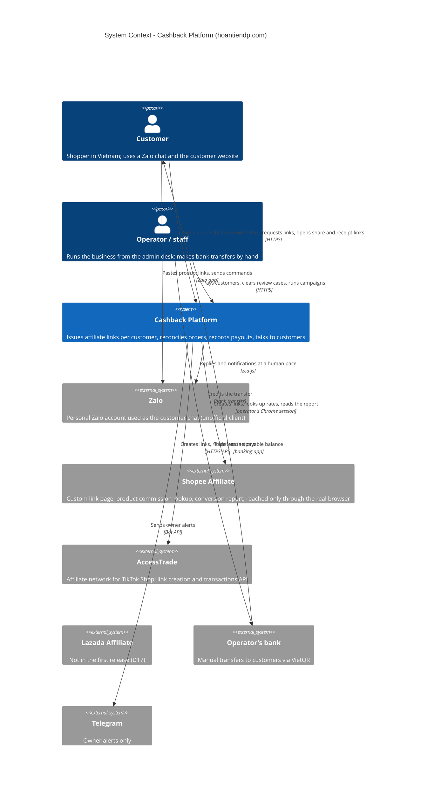

# C4 Context — Cashback Platform

Legend: blue boxes are people, the grey boxes are external systems, the dark box is the platform.
Lazada is drawn for completeness and is not connected in the first release (D17).

