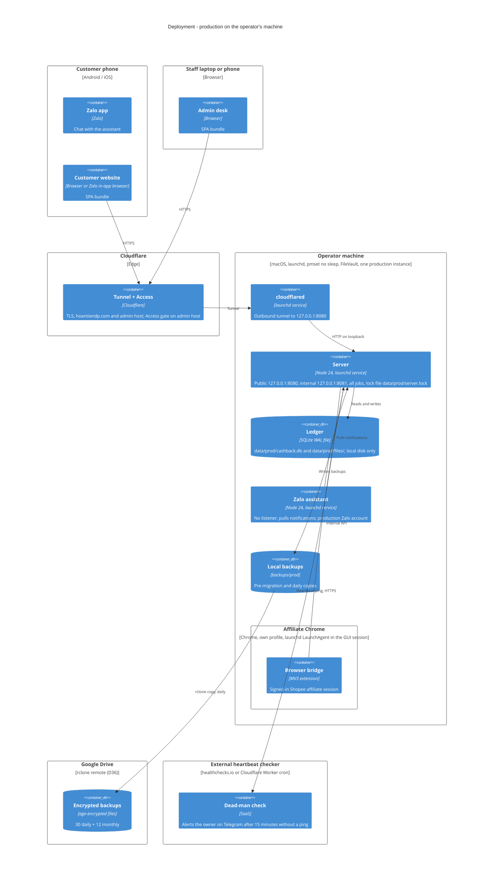

# C4 Deployment — Production and development

Legend: production runs on one operator machine (currently a Mac) as host processes under launchd;
there are no containers in v1 (AD-25). Only the public listener is reachable from the internet, and
only through the Cloudflare tunnel. Development runs on a separate machine or the same machine with
every resource different (ports, database, Zalo account, Chrome profile, no tunnel). Revised
2026-10-30 after the independent review: no assistant listener, Google Drive as the off-site store
(D36), an external heartbeat checker (AD-29), Chrome as a LaunchAgent, `pmset` no-sleep and
restart-after-power-failure.

## Development environment (same shape, nothing shared)

| Resource | Production | Development |
| --- | --- | --- |
| Public listener | 127.0.0.1:8080 | 127.0.0.1:9080 |
| Internal listener | 127.0.0.1:8081 | 127.0.0.1:9081 |
| Database | data/prod/cashback.db | data/dev/cashback.db (seeded or a scrubbed copy) |
| Zalo account | production account | a second account, or the fake client |
| Chrome profile | .browser-profile/prod | the fake bridge, or .browser-profile/dev never signed in to the production Shopee account |
| sub_id1 prefix | none | `DEV` (production attribution never resolves it, AD-25) |
| Tunnel | cloudflared to hoantiendp.com | none |
| PUBLIC_BASE_URL | https://hoantiendp.com | empty |
| PID and lock files | run/prod/*.pid, data/prod/server.lock | run/dev/*.pid, data/dev/server.lock |
| Secrets file | ~/.config/cashback/prod.env | ~/.config/cashback/dev.env |
