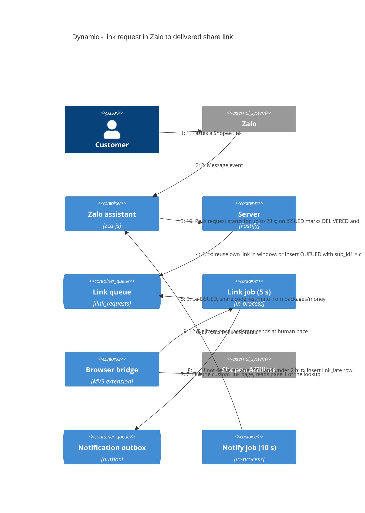
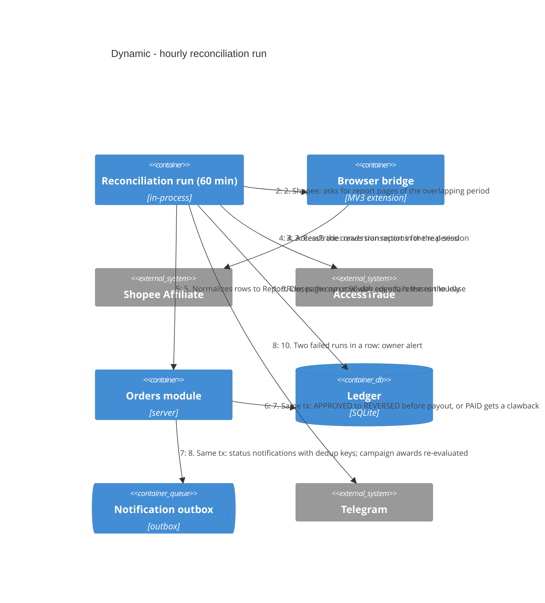
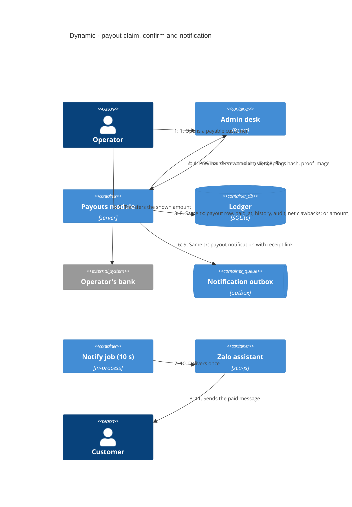
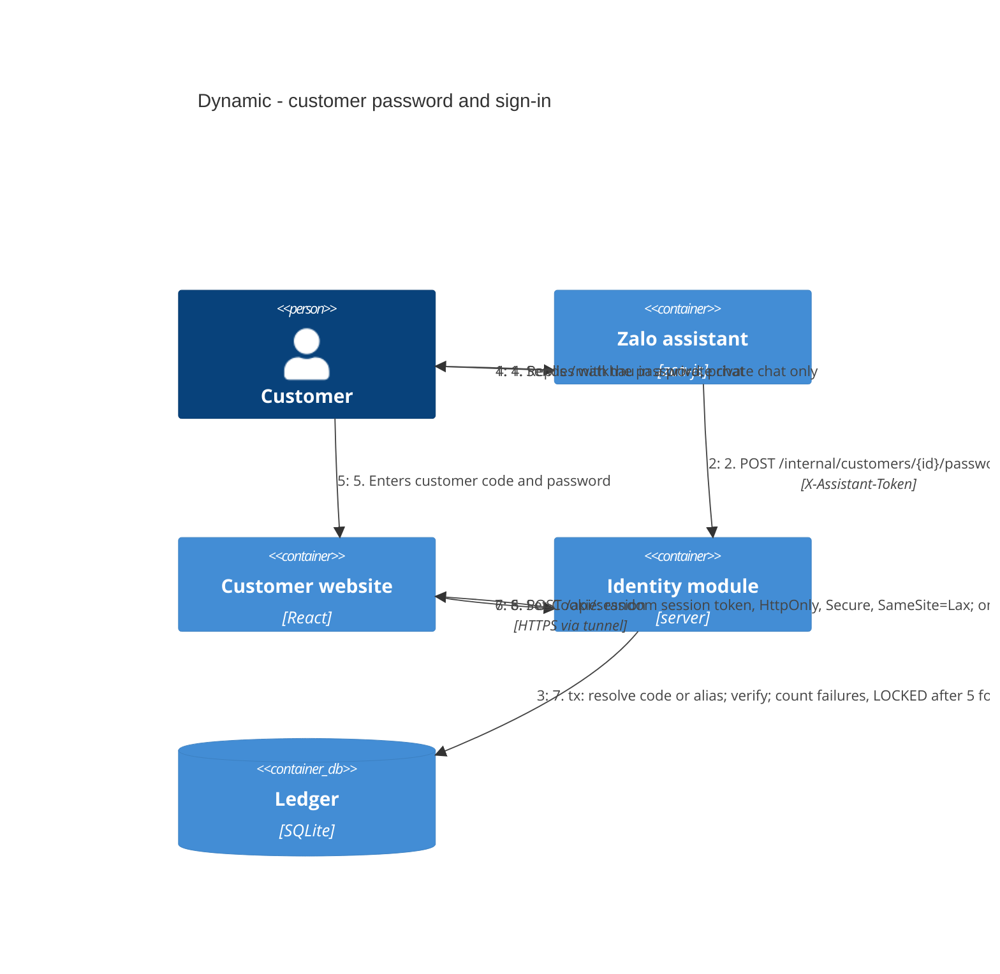

# C4 Dynamic — the four main flows

Legend: numbers give the order of steps. "tx" marks a step done inside one `BEGIN IMMEDIATE`
transaction on the ledger (AD-2). Elements match the Container diagram.

## 1. Link request to delivered link (FR-1, FR-4, FR-7, AD-14, AD-15, AD-16)

## 2. Reconciliation to approved or reversed order (FR-12, FR-13, D30, D31, AD-7, AD-8)

## 3. Payout claim to confirm to notified customer (FR-16, FR-17, D19, D32, AD-9)

## 4. Customer sign-in (FR-9, D21, AD-18)

