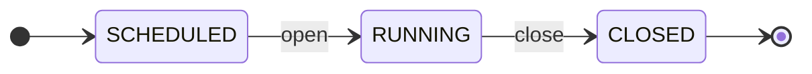
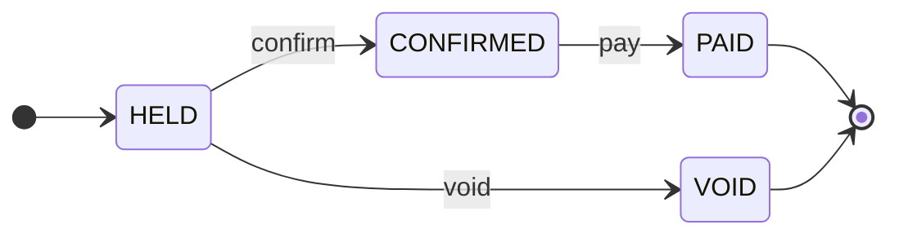

# Campaigns

`campaigns`

## Purpose & classification

> Run promotions without new code

**Subdomain type:** supporting · **Status:** observed · exists in code · **Strategic importance:** medium · **Owner:** Operator

Limited events that give a bonus to the first N qualifying orders recorded inside a time window.

**Subdomain:** Customer engagement (supporting)

Who the customer is, how we talk to them, and promotions.

## Ubiquitous language

| Term | Source | Note |
|---|---|---|
| `TimeWindow` | value-object | Type of field window on Campaign: Start inclusive, end exclusive. |
| `Money` | value-object | Type of field bonus on Campaign |

## Aggregates

### Campaign · `campaigns`
_observed · exists in code_
One promotion: its window, number of slots, bonus, minimum order value, networks, excluded customers and per-customer cap. It owns its slots.
**Identity:** `campaignId : CampaignId`
> Must be correct together: window, slot count and every award with its state.
**Invariants:**
- The number of held, confirmed and paid awards never exceeds the slot count.
- A slot belongs to an order, not a person.
- Staff, the guest account and excluded customers never hold a slot.
**5 fields:**
| Field | Type / reference | Required | Description |
|---|---|---|---|
| `campaignId` | `CampaignId` | yes |  |
| `window` | `TimeWindow` | yes | Start inclusive, end exclusive. |
| `slots` | `Count` | yes |  |
| `bonus` | `Money` | yes |  |
| `awards` | `CampaignAward[]` |  |  |

### CampaignAward · `campaign_awards`
_observed · exists in code_
One slot of a campaign held by one order.
**Identity:** _no identity yet_. No field names a single record.
> Part of the Campaign aggregate.
**Invariants:**
- One order holds at most one award per campaign.
**2 fields:**
| Field | Type / reference | Required | Description |
|---|---|---|---|
| `orderId` | → `orders.order` | yes |  |
| `status` | `AwardStatus` |  |  |

## Identity & building blocks

**Identity**: what names exactly one record. It separates an entity from a value object.

| Aggregate | Field | Type | Rule |
|---|---|---|---|
| Campaign | `campaignId` | `CampaignId` |  |
| CampaignAward | _no identity yet_ |  |  |

**Aggregate root** (1)

| Building block | Purpose | Detail | Scope |
|---|---|---|---|
| `Campaign` | Owns the window, the slots and every award. |  | aggregate, in campaigns.campaign |

**Domain service** (1)

| Building block | Purpose | Detail | Scope |
|---|---|---|---|
| `SlotEvaluation` | Fills free slots with the earliest qualifying orders while the campaign runs. |  | aggregate, in campaigns.campaign |

**Not modelled yet:** `entity`, `value-object`, `repository`, `specification`, `policy`, `read-model`. This is not always a gap: a supporting domain often keeps its rules inside the aggregate root.

## Lifecycle

### Campaign · `CampaignStatus`
A campaign opens at its start time and closes at its end time (D22: A campaign closes automatically at the end of its window, and the window end is exclusive everywhere).

**2 transitions**: guard, event emitted, what happens next

| From | Command | To | Guard | Emits | Then |
|---|---|---|---|---|---|
| SCHEDULED | open | RUNNING | — | — | The window starts. |
| RUNNING | close | CLOSED | — | campaigns.campaign.closed | The window ends. Freed slots are no longer refilled. |

### CampaignAward · `AwardStatus`

**3 transitions**: guard, event emitted, what happens next

| From | Command | To | Guard | Emits | Then |
|---|---|---|---|---|---|
| HELD | confirm | CONFIRMED | — | — | The order was approved. |
| HELD | void | VOID | — | campaigns.award.lost | The order was rejected. |
| CONFIRMED | pay | PAID | — | — | A payout covered the order and its bonus. |

## Commands & use cases

| Command / use case | From | Note |
|---|---|---|
| Create a campaign | Admin | An admin creates a campaign as one new record, not new code. |
| open | Campaign | The window starts. |
| close | Campaign | The window ends. Freed slots are no longer refilled. |
| confirm | CampaignAward | The order was approved. |
| void | CampaignAward | The order was rejected. |
| pay | CampaignAward | A payout covered the order and its bonus. |

## Events

- command `close` → aggregate `Campaign` → event **campaigns.campaign.closed**
- command `void` → aggregate `CampaignAward` → event **campaigns.award.lost**

Commands that emit no event (nothing elsewhere can react): `open`, `confirm`, `pay`

| Event | Happens when | Who listens |
|---|---|---|
| campaigns.award.held | An order took a campaign slot. The order-recorded message mentions it. | messaging |
| campaigns.award.lost | An order lost its slot because it was cancelled. The customer is told. | messaging |
| campaigns.campaign.closed | The campaign window ended. | operations |

## Rules & policies

**invariant** (5)

| Rule | Declared on | Status |
|---|---|---|
| A bonus is paid only together with the approved order's cashback. A held slot is never paid. | Campaign | observed · exists in code |
| The number of held, confirmed and paid awards never exceeds the slot count. | Campaign |  |
| A slot belongs to an order, not a person. | Campaign |  |
| Staff, the guest account and excluded customers never hold a slot. | Campaign |  |
| One order holds at most one award per campaign. | CampaignAward |  |

**policy** (2)

| Rule | Declared on | Status |
|---|---|---|
| Slots go to qualifying orders recorded inside the window, earliest first. | Campaign | observed · exists in code |
| A slot freed by a cancellation passes to the next order only while the campaign is running. | Campaign | observed · exists in code |

**specification** (1)

| Rule | Declared on | Status |
|---|---|---|
| The window end is exclusive in every calculation. | Campaign | target · agreed goal |

## Integration & hotspots

| Direction | Context | Kind | Via | Pattern | Status |
|---|---|---|---|---|---|
| notifies | Order Tracking | event | orders.order.* | published language | observed · exists in code |
| used by | Cashback Payouts | port | ConfirmedBonuses | customer–supplier | observed · exists in code |

**Related decisions** (2)

| Decision | Why | Status |
|---|---|---|
| A campaign closes automatically at the end of its window, and the window end is exclusive everywhere. | Today nothing closes a campaign and the v2 code disagreed with Python on the window end. Delegated to Claude by the project owner on 2026-10-30 (recommended option). | accepted · approved |
| Every instant is stored as UTC in one format. Business days, weeks, months and campaign windows are computed in Asia/Ho_Chi_Minh, and a date range includes its whole end day. | Three stored time formats compared as text make date filters return nothing and campaigns open 7 hours late. Delegated to Claude by the project owner on 2026-10-30 (recommended option, from the PRD review). | accepted · approved |
