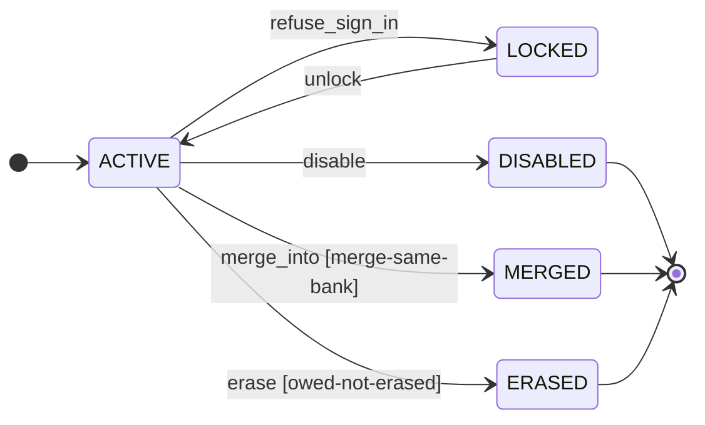

# Customer Identity

`identity`

## Purpose & classification

> Recognise customers and staff, and keep each customer's permanent identity

**Subdomain type:** supporting · **Status:** observed · exists in code · **Strategic importance:** high · **Owner:** Platform team

**Context map patterns:** open-host service

Who a customer is, how the customer is recognised from Zalo and the web, and who may act as staff.

**Subdomain:** Customer engagement (supporting)

Who the customer is, how we talk to them, and promotions.

## Ubiquitous language

| Term | Source | Note |
|---|---|---|
| `CustomerCode` | domain-primitive | DP plus five digits from a counter that only goes up. |
| `BankAccount` | value-object | Bank, account number of 4 to 30 letters and digits, and upper-case holder name. |

## Aggregates

### Customer · `customers`
_observed · exists in code_
A person who earns cashback. It holds the permanent customer id, the customer code, the bank account and the sign-in secret. The customer id never changes.
**Identity:** `customerId : CustomerId`. Today the Zalo UID seen by the assistant account.
> Must be correct together: customer id, customer code, aliases, role, bank account with consent, password and lock state.
**Invariants:**
- The customer id never changes once a link carries it.
- A customer code is issued once from a counter that only goes up and is never reused.
- A customer id that is an alias of another customer cannot become a new customer.
- Staff and the guest account have no customer code.
**9 fields:**
| Field | Type / reference | Required | Description |
|---|---|---|---|
| `customerId` | `CustomerId` | yes | Today the Zalo UID seen by the assistant account. |
| `customerCode` | `CustomerCode` |  | DP plus five digits, shown to the customer and used to sign in. |
| `role` | `CustomerRole` | yes |  |
| `status` | `CustomerStatus` | yes |  |
| `aliases` | `CustomerId[]` |  | Old Zalo UIDs and retired codes that point here. |
| `bankAccount` | `BankAccount` |  | Bank, account number and holder name, saved with consent. |
| `passwordHash` | `PasswordHash` |  |  |
| `failedSignIns` | `Count` |  |  |
| `lockedUntil` | `Instant` |  |  |

### Session · `sessions`
_observed · exists in code_
A signed-in browser of a customer or staff member. Only a hash of the token is stored.
**Identity:** `tokenHash : TokenHash`
> Must be correct together: token hash, owner and expiry.
**Invariants:**
- Only the hash of a session token is stored.
**3 fields:**
| Field | Type / reference | Required | Description |
|---|---|---|---|
| `tokenHash` | `TokenHash` | yes |  |
| `customerId` | → `identity.customer` |  |  |
| `expiresAt` | `Instant` |  |  |

## Identity & building blocks

**Identity**: what names exactly one record. It separates an entity from a value object.

| Aggregate | Field | Type | Rule |
|---|---|---|---|
| Customer | `customerId` | `CustomerId` | Today the Zalo UID seen by the assistant account. |
| Session | `tokenHash` | `TokenHash` |  |

**Aggregate root** (1)

| Building block | Purpose | Detail | Scope |
|---|---|---|---|
| `Customer` | Owns the permanent identity, code, aliases and bank account of a customer. |  | aggregate, in identity.customer |

**Value object** (1)

| Building block | Purpose | Detail | Scope |
|---|---|---|---|
| `BankAccount` | Bank, account number of 4 to 30 letters and digits, and upper-case holder name. |  | aggregate, in identity.customer |

**Domain primitive** (1)

| Building block | Purpose | Detail | Scope |
|---|---|---|---|
| `CustomerCode` | DP plus five digits from a counter that only goes up. |  | aggregate, in identity.customer |

**Domain service** (1)

| Building block | Purpose | Detail | Scope |
|---|---|---|---|
| `CustomerMerge` | Merges a duplicate into the survivor and keeps the old ids as aliases. |  | aggregate, in identity.customer |

**Not modelled yet:** `entity`, `repository`, `specification`, `policy`, `read-model`. This is not always a gap: a supporting domain often keeps its rules inside the aggregate root.

## Lifecycle

### Customer · `CustomerStatus`
A customer is active until staff disable the account, merge it into another, or erase it.

**5 transitions**: guard, event emitted, what happens next

| From | Command | To | Guard | Emits | Then |
|---|---|---|---|---|---|
| ACTIVE | refuse_sign_in | LOCKED | — | identity.customer.locked | Five failed sign-ins lock the account for 15 minutes. |
| LOCKED | unlock | ACTIVE | — | — | The lock ends after 15 minutes. |
| ACTIVE | disable | DISABLED | — | — | Staff disable the account. It can no longer sign in. |
| ACTIVE | merge_into | MERGED | merge-same-bank | identity.customer.merged | The operator merges a duplicate into the surviving customer. Its ids become aliases. |
| ACTIVE | erase | ERASED | owed-not-erased | identity.customer.erased | The operator erases the customer and the customer's history. |

## Commands & use cases

| Command / use case | From | Note |
|---|---|---|
| Register from Zalo | Zalo assistant | The assistant registers a person it has just seen in a private chat or the group. |
| Sign in on the web | Customer | A customer signs in with the customer code and password. |
| Issue a password | Customer | A customer asks the assistant for a new password with /matkhau. |
| Save a bank account | Customer | A customer saves or erases bank details in chat or on the web. |
| Merge duplicate customers | Operator | The operator reviews proposed pairs and merges each duplicate into the survivor. |
| refuse_sign_in | Customer | Five failed sign-ins lock the account for 15 minutes. |
| unlock | Customer | The lock ends after 15 minutes. |
| disable | Customer | Staff disable the account. It can no longer sign in. |
| merge_into | Customer | The operator merges a duplicate into the surviving customer. Its ids become aliases. |
| erase | Customer | The operator erases the customer and the customer's history. |

## Events

- command `refuse_sign_in` → aggregate `Customer` → event **identity.customer.locked**
- command `merge_into` → aggregate `Customer` → event **identity.customer.merged**
- command `erase` → aggregate `Customer` → event **identity.customer.erased**

Commands that emit no event (nothing elsewhere can react): `unlock`, `disable`

| Event | Happens when | Who listens |
|---|---|---|
| identity.customer.registered | A new customer was registered from Zalo. Linking may now issue links under the customer id. | linking, messaging |
| identity.customer.bank-account-changed | A customer saved or erased a bank account. Payouts read the new account; a recent change raises a review flag. | payouts, operations |
| identity.customer.merged | A duplicate customer was merged into a survivor. Old ids keep resolving to the survivor. | orders, payouts, campaigns |
| identity.customer.erased | A customer and the customer's history were erased. | orders, linking |
| identity.customer.locked | Too many failed sign-ins locked the account for 15 minutes. | operations |

## Rules & policies

**invariant** (7)

| Rule | Declared on | Status |
|---|---|---|
| Two customers with different bank accounts are never merged. | Customer | observed · exists in code |
| A customer who is still owed money is not erased unless the operator forces it (D13: A customer who is still owed money is never deleted, except by an explicit forced action of the operator). | Customer | observed · exists in code |
| The customer id never changes once a link carries it. | Customer |  |
| A customer code is issued once from a counter that only goes up and is never reused. | Customer |  |
| A customer id that is an alias of another customer cannot become a new customer. | Customer |  |
| Staff and the guest account have no customer code. | Customer |  |
| Only the hash of a session token is stored. | Session |  |

**policy** (4)

| Rule | Declared on | Status |
|---|---|---|
| An unknown customer code on the web is answered as not found. It never becomes a guest link. | Customer | observed · exists in code |
| A bank account is saved only with the customer's consent time, and only the last four digits are shown. | Customer | observed · exists in code |
| Issuing a new password ends every other session of that customer (D21: Issuing a new password ends every other session of that customer). | Customer | target · agreed goal |
| A session renews itself when it is used, so a customer stays signed in on a trusted phone. | Session | observed · exists in code |

**specification** (1)

| Rule | Declared on | Status |
|---|---|---|
| A customer is found by customer code, customer id or alias, ignoring case and spaces. | Customer | observed · exists in code |

**authorization** (2)

| Rule | Declared on | Status |
|---|---|---|
| A customer is created only from Zalo intent: the first private message or the first product link pasted in the group (D25: The assistant registers a person on the first private message or the first product link pasted in the community group). The public web never creates a customer. | Customer | observed · exists in code |
| The root admin account cannot be demoted or disabled. | Customer | observed · exists in code |

## Integration & hotspots

| Direction | Context | Kind | Via | Pattern | Status |
|---|---|---|---|---|---|
| used by | Link Issuing | port | CustomerDirectory | customer–supplier | observed · exists in code |
| used by | Order Tracking | port | CustomerDirectory | customer–supplier | observed · exists in code |
| used by | Cashback Payouts | port | BankAccountReader | customer–supplier | observed · exists in code |
