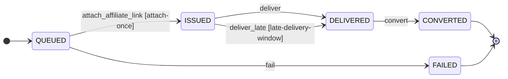

# Link Issuing

`linking`

## Purpose & classification

> Issue attributable affiliate links fast, without risking the affiliate accounts

**Subdomain type:** core · **Status:** observed · exists in code · **Strategic importance:** high · **Owner:** Platform team

**Context map patterns:** anti-corruption layer

Turns a product URL into an affiliate link that belongs to exactly one customer, and delivers it.

**Subdomain:** Attribution and cashback (core)

Issuing attributable links, tracking orders and paying cashback.

## Ubiquitous language

| Term | Source | Note |
|---|---|---|
| `SubId` | domain-primitive | A tag of letters and digits only. |
| `ShareCode` | domain-primitive | Eight random letters and digits, one per request. |
| `ProductUrl` | value-object | Type of field sourceUrl on LinkRequest |
| `AffiliateUrl` | value-object | Type of field affiliateUrl on LinkRequest |
| `SubIdSet` | value-object | Type of field subIds on LinkRequest: sub_id1 is the customer id, sub_id2 the request id. |
| `CashbackEstimate` | value-object | Type of field estimate on LinkRequest: Price, rates and estimated cashback at request time. Reference only. |
| `Money` | value-object | Type of field price on ProductOffer |
| `CommissionRate` | value-object | Type of field shopeeRate on ProductOffer |

## Aggregates

### LinkRequest · `link_requests`
_observed · exists in code_
One customer's request to turn one product URL into an affiliate link. It holds the source URL, the affiliate link, the share link and the estimate shown. It must never carry another customer's id.
**Identity:** `requestId : RequestId`
> Must be correct together: owner, network, source URL, affiliate link, sub_ids, share code, estimate and delivery time.
**Invariants:**
- A link request belongs to exactly one customer, written in sub_id1 (D6: A link belongs to exactly one customer through sub_id1. A link is reused only for the same customer).
- Every sub_id holds letters and digits only (D7: Every sub_id holds letters and digits only, and one link batch never mixes customers).
- An affiliate link is attached once and never replaced.
- One share code belongs to one link request.
**11 fields:**
| Field | Type / reference | Required | Description |
|---|---|---|---|
| `requestId` | `RequestId` | yes |  |
| `customerId` | → `identity.customer` | yes |  |
| `network` | `AffiliateNetwork` | yes |  |
| `channel` | `Channel` | yes |  |
| `sourceUrl` | `ProductUrl` | yes |  |
| `affiliateUrl` | `AffiliateUrl` |  |  |
| `subIds` | `SubIdSet` |  | sub_id1 is the customer id, sub_id2 the request id. |
| `shareCode` | `ShareCode` |  | Eight random letters and digits. |
| `estimate` | `CashbackEstimate` |  | Price, rates and estimated cashback at request time. Reference only. |
| `attempts` | `Count` |  |  |
| `deliveredAt` | `Instant` |  | Set by whoever hands the link over first. |

### ProductOffer · `products_cache`
_observed · exists in code_
The shared facts of one product on one network: price, commission rates, cap flag and estimated cashback. It holds no customer data.
**Identity:** `itemId : ItemId`
> Must be correct together: price, Shopee rate, shop rate and the capped estimate.
**Invariants:**
- Shopee's part of the estimate is capped at 40,000 dong; the shop's XTRA part is not (D2: Shopee's part of a commission is capped at 40,000 dong per order).
**5 fields:**
| Field | Type / reference | Required | Description |
|---|---|---|---|
| `itemId` | `ItemId` | yes |  |
| `price` | `Money` |  |  |
| `shopeeRate` | `CommissionRate` |  |  |
| `shopRate` | `CommissionRate` |  |  |
| `refreshedAt` | `Instant` |  |  |

### LinkClick · `link_clicks`
_observed · exists in code_
One visit to a share link by a person. Preview bots and HEAD requests are not recorded.
**Identity:** _no identity yet_. No field names a single record.
> Must be correct together: share code, time and browser kind.
**Invariants:**
- A click always belongs to an existing share code.
**3 fields:**
| Field | Type / reference | Required | Description |
|---|---|---|---|
| `shareCode` | → `linking.link-request` | yes |  |
| `agent` | `ClickAgent` |  |  |
| `clickedAt` | `Instant` |  |  |

## Identity & building blocks

**Identity**: what names exactly one record. It separates an entity from a value object.

| Aggregate | Field | Type | Rule |
|---|---|---|---|
| LinkRequest | `requestId` | `RequestId` |  |
| ProductOffer | `itemId` | `ItemId` |  |
| LinkClick | _no identity yet_ |  |  |

**Aggregate root** (1)

| Building block | Purpose | Detail | Scope |
|---|---|---|---|
| `LinkRequest` | Owns one customer's link and guarantees it never carries another customer's id. |  | aggregate, in linking.link-request |

**Domain primitive** (2)

| Building block | Purpose | Detail | Scope |
|---|---|---|---|
| `SubId` | A tag of letters and digits only. |  | aggregate, in linking.link-request |
| `ShareCode` | Eight random letters and digits, one per request. |  | aggregate, in linking.link-request |

**Policy** (1)

| Building block | Purpose | Detail | Scope |
|---|---|---|---|
| `LinkReusePolicy` | Decides whether a repeat request reuses the customer's own link or makes a fresh one. |  | aggregate, in linking.link-request |

**Port** (1)

| Building block | Purpose | Detail | Scope |
|---|---|---|---|
| `AffiliateNetworkPort` | Creates affiliate links and looks up product rates on one network. |  | integration |

**Anti-corruption layer** (2)

| Building block | Purpose | Detail | Scope |
|---|---|---|---|
| `ShopeeAdapter` | Shopee links and commission lookups go through the operator's signed-in Chrome (D8: Every call to Shopee goes through the operator's real signed-in browser). Via: Browser bridge. |  | integration |
| `AccessTradeAdapter` | TikTok Shop links are created through AccessTrade with sub1 and sub2. Via: AccessTrade API. |  | integration |

**Process manager** (1)

| Building block | Purpose | Detail | Scope |
|---|---|---|---|
| `LinkQueue` | Orders waiting requests by channel and age and feeds one customer per browser pass. |  | bounded-context |

**Not modelled yet:** `entity`, `value-object`, `domain-service`, `repository`, `specification`, `read-model`. This is not always a gap: a supporting domain often keeps its rules inside the aggregate root.

## Lifecycle

### LinkRequest · `LinkRequestStatus`
A link request waits in the link queue, gets its affiliate link, is delivered, and is converted when an order arrives. Leaving the attribution window is derived from time, not stored (D23: A link request has no expired state. Being outside the attribution window is derived from the request time).

**5 transitions**: guard, event emitted, what happens next

| From | Command | To | Guard | Emits | Then |
|---|---|---|---|---|---|
| QUEUED | attach_affiliate_link | ISSUED | attach-once | linking.link-request.issued | The browser bridge returns the affiliate link for this request. |
| QUEUED | fail | FAILED | — | linking.link-request.failed | The customer is told the link could not be made. · Three counted attempts failed. Captcha and page errors are retried without counting. |
| ISSUED | deliver | DELIVERED | — | linking.link-request.delivered | The assistant or the web hands the link to the customer. |
| ISSUED | deliver_late | DELIVERED | late-delivery-window | linking.link-request.delivered | The notifier sends a link unclaimed after 55 seconds and younger than 2 hours. |
| DELIVERED | convert | CONVERTED | — | — | Reconciliation records an order attributed to this request. |

## Commands & use cases

| Command / use case | From | Note |
|---|---|---|
| Request a link in Zalo | Customer | A customer pastes a product link in chat. The assistant waits up to 52 seconds and replies with the share link. |
| Request a link on the web | Customer | A customer or guest pastes a product link on the website and gets the affiliate link or a guest warning. |
| Open a share link | Customer | A buyer opens hoantiendp.com/s/<code>. A real browser is redirected; an in-app browser is guided out first. |
| attach_affiliate_link | LinkRequest | The browser bridge returns the affiliate link for this request. |
| fail | LinkRequest | Three counted attempts failed. Captcha and page errors are retried without counting. |
| deliver | LinkRequest | The assistant or the web hands the link to the customer. |
| deliver_late | LinkRequest | The notifier sends a link unclaimed after 55 seconds and younger than 2 hours. |
| convert | LinkRequest | Reconciliation records an order attributed to this request. |

## Events

- command `attach_affiliate_link` → aggregate `LinkRequest` → event **linking.link-request.issued**
- command `fail` → aggregate `LinkRequest` → event **linking.link-request.failed**; then The customer is told the link could not be made.
- command `deliver` → aggregate `LinkRequest` → event **linking.link-request.delivered**
- command `deliver_late` → aggregate `LinkRequest` → event **linking.link-request.delivered**

Commands that emit no event (nothing elsewhere can react): `convert`

| Event | Happens when | Who listens |
|---|---|---|
| linking.link-request.issued | The browser bridge returned the affiliate link. The waiting assistant or web page can deliver it. | messaging |
| linking.link-request.delivered | The customer received the link. It is never sent again. | operations |
| linking.link-request.failed | The link could not be made after three attempts. The customer is told. | messaging, operations |

## Rules & policies

**invariant** (8)

| Rule | Declared on | Status |
|---|---|---|
| One browser submission carries one customer only, because the network applies one sub_id to the whole batch (D7: Every sub_id holds letters and digits only, and one link batch never mixes customers). | LinkRequest | observed · exists in code |
| A request that already has an affiliate link refuses another one, and a link already stored for a different source URL is refused as a stale page answer. | LinkRequest | observed · exists in code |
| A link request belongs to exactly one customer, written in sub_id1 (D6: A link belongs to exactly one customer through sub_id1. A link is reused only for the same customer). | LinkRequest |  |
| Every sub_id holds letters and digits only (D7: Every sub_id holds letters and digits only, and one link batch never mixes customers). | LinkRequest |  |
| An affiliate link is attached once and never replaced. | LinkRequest |  |
| One share code belongs to one link request. | LinkRequest |  |
| Shopee's part of the estimate is capped at 40,000 dong; the shop's XTRA part is not (D2: Shopee's part of a commission is capped at 40,000 dong per order). | ProductOffer |  |
| A click always belongs to an existing share code. | LinkClick |  |

**policy** (8)

| Rule | Declared on | Status |
|---|---|---|
| A link is reused only for the same customer and the same source URL inside the attribution window. Product facts may be shared across customers. | LinkRequest | observed · exists in code |
| Guest requests reuse one HOUSE link per product (D5: A link made without a customer code belongs to the guest account HOUSE). | LinkRequest | observed · exists in code |
| A late link is sent only between 55 seconds and 2 hours after it was issued. Older links are marked delivered without a message. | LinkRequest | observed · exists in code |
| The website may issue 60 new links per hour in total and 20 per customer code per day. Zalo has no quota. | LinkRequest | observed · exists in code |
| Every call to Shopee goes through the operator's signed-in browser. No forged signatures, and commission lookups read page 1 only (D8: Every call to Shopee goes through the operator's real signed-in browser). | LinkRequest | observed · exists in code |
| Chat always delivers the share link, because purchases inside the Zalo in-app browser are not attributed. | LinkRequest | observed · exists in code |
| The 20 most requested products are refreshed when older than 6 hours. | ProductOffer | observed · exists in code |
| Decides whether a repeat request reuses the customer's own link or makes a fresh one. | linking.link-request | observed · exists in code |

**specification** (1)

| Rule | Declared on | Status |
|---|---|---|
| An affiliate link never expires. The attribution window only decides when a repeat request makes a fresh link (D23: A link request has no expired state. Being outside the attribution window is derived from the request time). | LinkRequest | target · agreed goal |

**workflow** (1)

| Rule | Declared on | Status |
|---|---|---|
| The link queue serves Zalo first, then web customers, then guests, then the oldest request. | LinkRequest | observed · exists in code |

## Integration & hotspots

| Direction | Context | Kind | Via | Pattern | Status |
|---|---|---|---|---|---|
| calls | Customer Identity | port | CustomerDirectory | customer–supplier | observed · exists in code |
| used by | Order Tracking | reference | RequestId in sub_id2 | upstream–downstream | observed · exists in code |
| listens to | Customer Conversation | event | linking.link-request.* | published language | observed · exists in code |

**Related decisions** (1)

| Decision | Why | Status |
|---|---|---|
| The Link Issuing context owns the affiliate network catalog: caps, sub_id format, link creation and report shape per network. Other contexts read it as published language. | Network rules change together with link creation; one owner avoids two copies drifting, as the Shopee domain list once did. Delegated to Claude by the project owner on 2026-10-30 (recommended option). | accepted · approved |
