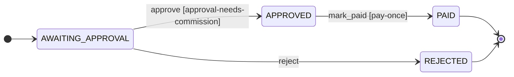
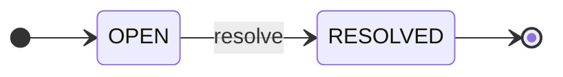

# Order Tracking

`orders`

## Purpose & classification

> Know exactly which customer earned which approved commission

**Subdomain type:** core · **Status:** observed · exists in code · **Strategic importance:** high · **Owner:** Platform team

**Context map patterns:** anti-corruption layer, published language

Reads the networks' conversion reports, attributes each order to a customer, and follows it to approval or cancellation.

**Subdomain:** Attribution and cashback (core)

Issuing attributable links, tracking orders and paying cashback.

## Ubiquitous language

| Term | Source | Note |
|---|---|---|
| `CommissionSplit` | shared-kernel | The one implementation of the cap, fee, tax, cashback share and half-up rounding, used by every context. |
| `Money` | value-object | Type of field orderValue on Order |

## Aggregates

### Order · `orders`
_observed · exists in code_
One purchase a network reported, attributed to one customer. It holds the order value, the estimated and approved commission and the cashback owed. A paid order never changes.
**Identity:** `orderId : OrderId`. The network's order number or transaction id.
> Must be correct together: owner, network, status, estimated and approved commission, cashback, paid time and status history.
**Invariants:**
- Cashback is calculated from the approved commission only (D3: Cashback is calculated from the approved commission only, never from the estimate shown to the customer).
- An order with a paid time is never changed or paid again (D4: An order with a payout time (paid_at) is never changed or paid again).
- An approved order is never rejected later.
- A guest order always has 0 cashback and is never moved to another customer (D5: A link made without a customer code belongs to the guest account HOUSE).
- Every status change is appended to the status history.
**12 fields:**
| Field | Type / reference | Required | Description |
|---|---|---|---|
| `orderId` | `OrderId` | yes | The network's order number or transaction id. |
| `customerId` | → `identity.customer` | yes |  |
| `requestId` | → `linking.link-request` |  |  |
| `network` | `AffiliateNetwork` | yes |  |
| `status` | `OrderStatus` | yes |  |
| `orderValue` | `Money` |  |  |
| `estimatedCommission` | `Money` |  |  |
| `approvedCommission` | `Money` |  |  |
| `cashback` | `Money` |  | Derived from the approved commission by the commission split. |
| `recordedAt` | `Instant` |  | When the platform first recorded the order. Campaign ranking uses it. |
| `paidAt` | `Instant` |  |  |
| `settlement` | `SettlementStatus` |  | Whether the network has paid the operator for this order. |

### ReviewCase · `manual_review`
_observed · exists in code_
A report row the system will not guess at, waiting for the operator. One open case per order and reason.
**Identity:** `caseId : ReviewCaseId`
> Must be correct together: order id, reason, report row and resolution.
**Invariants:**
- Only one open review case exists per order and reason.
**4 fields:**
| Field | Type / reference | Required | Description |
|---|---|---|---|
| `caseId` | `ReviewCaseId` | yes |  |
| `orderId` | `OrderId` |  |  |
| `reason` | `ReviewReason` |  |  |
| `resolved` | `Boolean` |  |  |

## Identity & building blocks

**Identity**: what names exactly one record. It separates an entity from a value object.

| Aggregate | Field | Type | Rule |
|---|---|---|---|
| Order | `orderId` | `OrderId` | The network's order number or transaction id. |
| ReviewCase | `caseId` | `ReviewCaseId` |  |

**Aggregate root** (1)

| Building block | Purpose | Detail | Scope |
|---|---|---|---|
| `Order` | Owns an order's status, commission and cashback, and refuses any change after payment. |  | aggregate, in orders.order |

**Domain service** (1)

| Building block | Purpose | Detail | Scope |
|---|---|---|---|
| `OrderAttribution` | Finds the customer of a report row by sub_id1, alias, then request owner. |  | aggregate, in orders.order |

**Anti-corruption layer** (3)

| Building block | Purpose | Detail | Scope |
|---|---|---|---|
| `ConversionReportTranslator` | Translates each network's report rows and statuses into the Order language. |  | integration |
| `ShopeeReportAdapter` | Shopee conversion reports are read page by page through the same browser. Via: Browser bridge report reader. |  | integration |
| `AccessTradeReportAdapter` | AccessTrade transactions are grouped per order and translated. Via: AccessTrade transactions API. |  | integration |

**Process manager** (1)

| Building block | Purpose | Detail | Scope |
|---|---|---|---|
| `ReconciliationRun` | Reads each network report every hour and applies it idempotently. |  | bounded-context |

**Shared kernel** (1)

| Building block | Purpose | Detail | Scope |
|---|---|---|---|
| `CommissionSplit` | The one implementation of the cap, fee, tax, cashback share and half-up rounding, used by every context. |  | shared-kernel |

**Not modelled yet:** `entity`, `value-object`, `repository`, `specification`, `policy`, `read-model`. This is not always a gap: a supporting domain often keeps its rules inside the aggregate root.

## Lifecycle

### Order · `OrderStatus`
A recorded order waits for the network's approval, then waits for the operator's payout.

**3 transitions**: guard, event emitted, what happens next

| From | Command | To | Guard | Emits | Then |
|---|---|---|---|---|---|
| AWAITING_APPROVAL | approve | APPROVED | approval-needs-commission | orders.order.approved | The customer balance grows. · The customer is told the amount, without a payout date (D11: Every approved, unpaid order is payable, grouped by customer). · Reconciliation sees the network approve the order with a commission figure. The cashback becomes owed. |
| AWAITING_APPROVAL | reject | REJECTED | — | orders.order.rejected | The customer is told the reason. · Reconciliation sees the network cancel the order. |
| APPROVED | mark_paid | PAID | pay-once | orders.order.paid | A payout covering this order is recorded. |

### ReviewCase

**1 transitions**: guard, event emitted, what happens next

| From | Command | To | Guard | Emits | Then |
|---|---|---|---|---|---|
| OPEN | resolve | RESOLVED | — | — | The operator applies or dismisses the row. |

## Commands & use cases

| Command / use case | From | Note |
|---|---|---|
| Reconcile a network report | Reconciliation run | Every hour the system reads each network's report and records, approves or rejects orders. |
| View my orders | Customer | A customer reads the order list and balance with /donhang or on the web. |
| Resolve a manual review | Operator | The operator decides a report row the system would not guess at. |
| approve | Order | Reconciliation sees the network approve the order with a commission figure. The cashback becomes owed. |
| reject | Order | Reconciliation sees the network cancel the order. |
| mark_paid | Order | A payout covering this order is recorded. |
| resolve | ReviewCase | The operator applies or dismisses the row. |

## Events

- command `approve` → aggregate `Order` → event **orders.order.approved**; then The customer balance grows.; The customer is told the amount, without a payout date (D11: Every approved, unpaid order is payable, grouped by customer).
- command `reject` → aggregate `Order` → event **orders.order.rejected**; then The customer is told the reason.
- command `mark_paid` → aggregate `Order` → event **orders.order.paid**

Commands that emit no event (nothing elsewhere can react): `resolve`

| Event | Happens when | Who listens |
|---|---|---|
| orders.order.recorded | A network reported a new attributed order. The customer is told the estimate; campaigns may give it a slot. | messaging, campaigns, linking |
| orders.order.approved | The network approved the order. The cashback is now owed to the customer. | payouts, campaigns, messaging |
| orders.order.rejected | The network cancelled the order. No cashback is owed; a held campaign slot is freed. | campaigns, messaging |
| orders.order.paid | A payout covered the order. It never changes again. | campaigns, messaging |

## Rules & policies

**invariant** (9)

| Rule | Declared on | Status |
|---|---|---|
| An order is approved only when the report carries a commission figure; otherwise it goes to manual review. | Order | observed · exists in code |
| Only an approved order without a paid time can be marked paid (D4: An order with a payout time (paid_at) is never changed or paid again). | Order | observed · exists in code |
| Running reconciliation again over the same period leaves every order unchanged. | Order | observed · exists in code |
| Cashback is calculated from the approved commission only (D3: Cashback is calculated from the approved commission only, never from the estimate shown to the customer). | Order |  |
| An order with a paid time is never changed or paid again (D4: An order with a payout time (paid_at) is never changed or paid again). | Order |  |
| An approved order is never rejected later. | Order |  |
| A guest order always has 0 cashback and is never moved to another customer (D5: A link made without a customer code belongs to the guest account HOUSE). | Order |  |
| Every status change is appended to the status history. | Order |  |
| Only one open review case exists per order and reason. | ReviewCase |  |

**policy** (1)

| Rule | Declared on | Status |
|---|---|---|
| A report status the system does not know goes to manual review instead of a guess. | Order | observed · exists in code |

**specification** (2)

| Rule | Declared on | Status |
|---|---|---|
| Shopee's completed, delivered and paid statuses mean awaiting approval. Only validated or approved means approved. | Order | observed · exists in code |
| AccessTrade lines are grouped per transaction. The order is approved only when every non-rejected line is confirmed, and rejected when every line is rejected. | Order | observed · exists in code |

**workflow** (1)

| Rule | Declared on | Status |
|---|---|---|
| Reconciliation attributes an order by sub_id1, then by customer alias, then by the owner of the sub_id2 request. Anything else goes to manual review. | Order | observed · exists in code |

## Integration & hotspots

| Direction | Context | Kind | Via | Pattern | Status |
|---|---|---|---|---|---|
| calls | Customer Identity | port | CustomerDirectory | customer–supplier | observed · exists in code |
| calls | Link Issuing | reference | RequestId in sub_id2 | upstream–downstream | observed · exists in code |
| listens to | Cashback Payouts | event | orders.order.approved | published language | observed · exists in code |
| listens to | Campaigns | event | orders.order.* | published language | observed · exists in code |
| listens to | Customer Conversation | event | orders.order.* | published language | observed · exists in code |
