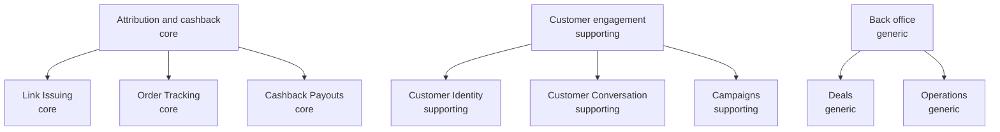

# Strategic Domain Map

**Primary domain:** `orders`

The business is trustworthy attribution and exact payment: a link that belongs to one customer, an order traced to that customer, and a payout made once from the approved commission. Linking, Order Tracking and Cashback Payouts are core. Identity, Campaigns and Customer Conversation support them. Deals and Operations are generic.

## Classification

| Subdomain | Type | Contexts | Description |
|---|---|---|---|
| `Attribution and cashback` | `core` | linking, orders, payouts | Issuing attributable links, tracking orders and paying cashback. |
| `Customer engagement` | `supporting` | identity, messaging, campaigns | Who the customer is, how we talk to them, and promotions. |
| `Back office` | `generic` | catalog, operations | Deals, audit, alerts and metrics. |
